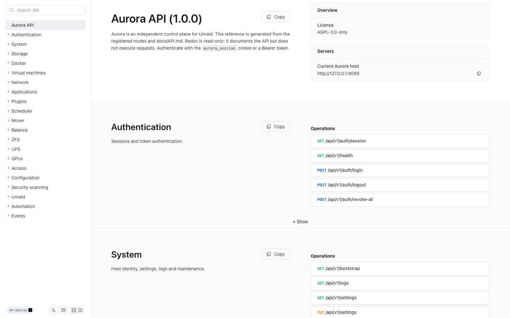

# Aurora HTTP API

Aurora exposes a typed JSON API for the embedded React UI and for automation. This
document is the maintained reference; the route table in
[ARCHITECTURE.md](ARCHITECTURE.md#5-http-surface) is a shorter map.



- Base URL: `https://<host>:8484/api/v1`
- Rendered reference: `https://<host>:8484/api/docs` (Redoc, read-only)
- OpenAPI 3.1 document: `GET /api/openapi.json`
- Generator: `python3 scripts/openapi.py` (also copied to `backend/internal/api/apidocs/openapi.json` for embedding)
- Content type: `application/json; charset=utf-8`
- Source of truth: [`backend/internal/api/server.go`](../backend/internal/api/server.go)
- Typed models: [`backend/internal/model`](../backend/internal/model) and
  [`frontend/src/lib/types.ts`](../frontend/src/lib/types.ts)

## Authentication

Aurora accepts two kinds of credentials.

### Browser session

1. `POST /api/v1/auth/login` with the host `root` credentials.
2. Aurora returns an HttpOnly, SameSite=Lax `aurora_session` cookie signed with
   HMAC-SHA256.
3. Mutating requests using the cookie must also send `X-Aurora-Request: aurora`.
   Cross-origin requests are rejected unless the `Origin` host matches.
4. Sessions last `AURORA_SESSION_TTL` (24 h by default). The HMAC secret and the
   session registry live in the Aurora config directory, so signed-in devices
   survive an Aurora restart. `POST /api/v1/auth/revoke-all` rotates the session
   epoch and invalidates every existing cookie, including the caller's.

Login failures are rate limited: three failed attempts from one address trigger
a 15 minute cooldown, matching the Unraid webGUI.

### API tokens

Create a token in **Settings → API tokens** or with `POST /api/v1/tokens` from a
signed-in session. Set `expiresInDays` (0 = never); expired tokens are rejected
even if their hash is still stored. Optional `scopes` restricts a token to
`docker`, `vms`, `storage`, `network`, `system`, `ups`, `apps`, `automation` or
`access`; an empty list keeps the role-wide access. The secret is shown once. Send it as:

```http
Authorization: Bearer <token>
```

Token management itself always requires a session; a token cannot create or
revoke tokens. The `AURORA_METRICS_TOKEN` value, when set, is also accepted by
`GET /metrics`.

#### Roles

| Role | Read | Mutations |
|---|---|---|
| `viewer` | dashboards and non-sensitive metadata | none |
| `operator` | viewer reads + VM XML/console and container configuration | `/actions`, `/array/`, `/disks/`, `/docker/`, `/vms/`, `/mover`, `/balance/` |
| `admin` | everything, including secrets | everything |

Sensitive reads are admin-only: `/settings`, `/audit`, `/logs`, `/unraid-api/logs`,
`/ups/settings`, `/config/export`, `/tools/flash-backup`, `/tools/diagnostics`,
`/config-history`, `/users` (except icons), `/user-scripts/{id}` and `/terminal`.
The VM console, domain XML/advanced config and container configuration require
at least `operator`. `GET /bootstrap` redacts webhook URLs, headers and bodies for
non-admin tokens. Token management itself always requires a signed-in session.

The host configuration surface (settings, users, tokens, plugins, OS, network,
scheduler, UPS, Trivy, configuration import/rollback) is admin-only. A
signed-in root session is equivalent to `admin`.

## Conventions

- Successful responses are JSON objects or arrays. The `GET /api/v1/events`
  endpoint is `text/event-stream`; console and terminal endpoints upgrade to a
  WebSocket.
- Errors use a stable envelope:

```json
{
  "error": {
    "code": "invalid_body",
    "message": "invalid JSON body: ..."
  }
}
```

- Request bodies are limited to 1 MiB. Unknown fields are rejected.
- Timestamps are RFC3339 strings or Unix seconds, depending on the model.
- Byte sizes are numbers, not formatted strings.
- `AURORA_READ_ONLY=1` rejects every mutation with HTTP 403, including token and
  settings changes. Reads keep working.
- Long-running operations use:
  - **NDJSON** (`application/x-ndjson`) for plugin, container and OS update
    progress;
  - **SSE** for metrics;
  - **WebSocket** for the VM console and the root terminal.
- Selected endpoints send a `Server-Timing` header, for example
  `bootstrap;dur=142.3`, to help profile the UI.

## Endpoint reference

Unless marked public, every endpoint requires a valid session or bearer token.
"Admin" means admin token or signed-in root session.

### Health, auth and bootstrap

| Method | Path | Access | Description |
|---|---|---|---|
| GET | `/health` | public | Liveness, version, provider, uptime |
| GET | `/auth/session` | public | `{authenticated, user}` |
| POST | `/auth/login` | public | `{username,password}` → session cookie |
| POST | `/auth/logout` | session | Clear the cookie |
| POST | `/auth/revoke-all` | session | Invalidate every session |
| GET | `/auth/sessions` | session | List active sessions and the current device |
| DELETE | `/auth/sessions/{nonce}` | session | Revoke one session by nonce |
| GET | `/bootstrap` | viewer+ | Full snapshot, hub metrics and history; `?light=1` skips plugins/notifications |
| GET | `/events` | viewer+ | SSE metrics stream |
| GET | `/system` | viewer+ | System identity, CPU, memory, sensors |
| GET | `/settings` | admin | UI and integration settings (secrets redacted for tokens) |
| PUT | `/settings` | admin | Persist validated settings |

`GET /bootstrap` returns `Snapshot`: system, array, disks, shares, pools,
containers, VMs, network, users, plugins, notifications, GPUs, UPS, settings,
metrics, history and `serverTime`. Collections are always arrays, never `null`.
`?light=1` omits plugins, notifications, GPUs, UPS and history. The UI loads
plugins/notifications from their dedicated endpoints and the remaining fields
from the SSE hub, so first paint is cheaper without extra host probes. JSON reads
are gzip-compressed when the client sends `Accept-Encoding: gzip`.

### Array, disks, shares and pools

| Method | Path | Access | Description |
|---|---|---|---|
| GET | `/array` | viewer+ | Array status, parity, rebuild and history |
| POST | `/array/start` | operator | Start the array, optionally with a LUKS key |
| POST | `/array/stop` | operator | Stop the array |
| GET | `/disks` | viewer+ | Devices with I/O, SMART state and identity |
| GET | `/disks/{device}/smart` | viewer+ | SMART health and attributes |
| POST | `/disks/{device}/smart-test` | operator | Start a short self-test |
| GET | `/pools` | viewer+ | Cache/boot pools |
| GET | `/shares` | viewer+ | Shares and protocol state |
| GET | `/shares/{name}/config` | viewer+ | Editable share configuration |
| POST | `/shares` | admin | Create a share |
| POST | `/shares/usage/refresh` | admin | Force a background share-usage rescan (`name` optional) |
| PUT | `/shares/{name}` | admin | Cache mode, allocator, disks, COW |
| PUT | `/shares/{name}/smb` | admin | SMB export, security, case |
| PUT | `/shares/{name}/nfs` | admin | NFS export, security, host rules |
| GET | `/parity/history` | viewer+ | Historical parity checks |

### Docker

| Method | Path | Access | Description |
|---|---|---|---|
| GET | `/docker/containers` | viewer+ | Containers, stats, ports, health, security |
| POST | `/docker/containers` | operator | Create and start a container |
| GET | `/docker/containers/{id}/config` | operator+ | Editable container configuration |
| PUT | `/docker/containers/{id}/config` | operator | Recreate with new paths/ports/env |
| DELETE | `/docker/containers/{id}` | operator | Remove a container |
| POST | `/docker/containers/bulk` | operator | Start/stop/restart up to 100 containers |
| PUT | `/docker/containers/{id}/autostart` | operator | Toggle Unraid autostart |
| GET | `/docker/containers/{id}/logs?lines=` | viewer+ | Log tail |
| GET | `/docker/containers/{id}/connections` | viewer+ | Observed network sockets |
| GET | `/docker/containers/{id}/icon` | viewer+ | Cached Unraid icon |
| GET | `/docker/networks` | viewer+ | Docker networks |
| GET | `/docker/templates` | viewer+ | Unraid XML templates |
| POST | `/docker/check-updates` | operator | Compare local and registry digests |
| POST | `/docker/containers/{id}/update` | operator | NDJSON pull/recreate stream |
| GET | `/docker/security` | viewer+ | Merged Trivy overview |
| GET | `/docker/containers/{id}/security` | viewer+ | Per-container Trivy detail |
| POST | `/docker/containers/{id}/scan` | operator | Force an image scan |
| POST | `/docker/scan-all` | operator | Queue every container image |

`POST /docker/containers/bulk` body:

```json
{
  "action": "restart",
  "targets": ["plex", "sonarr"]
}
```

Response:

```json
{
  "ok": true,
  "succeeded": ["plex", "sonarr"],
  "failed": []
}
```

### Virtual machines

| Method | Path | Access | Description |
|---|---|---|---|
| GET | `/vms` | viewer+ | VM inventory and live usage |
| POST | `/vms` | operator | Create a VM |
| GET | `/vms/host-devices` | viewer+ | PCI/USB inventory and IOMMU groups |
| GET | `/vms/{id}/icon` | viewer+ | Unraid VM icon |
| GET | `/vms/{id}/xml` | operator+ | Libvirt domain XML |
| PUT | `/vms/{id}/xml` | operator | Replace the domain definition |
| GET | `/vms/{id}/advanced` | operator+ | Guided hardware configuration |
| PUT | `/vms/{id}/advanced` | operator | Rewrite CPU/network/sound/hostdev/shared folders |
| POST | `/vms/{id}/clone` | operator | Clone domain, disks and NVRAM |
| POST | `/vms/{id}/resize` | operator | Expand the first file-backed vDisk |
| POST | `/vms/{id}/usb/attach` | operator | Hot-plug or persist a host USB device |
| POST | `/vms/{id}/usb/detach` | operator | Remove a host USB device |
| PUT | `/vms/{id}/autostart` | operator | Toggle libvirt autostart |
| GET | `/vms/{id}/snapshots` | viewer+ | List snapshots |
| POST | `/vms/{id}/snapshots` | operator | Create a snapshot |
| POST | `/vms/{id}/snapshots/{snapshot}/revert` | operator | Restore a snapshot |
| DELETE | `/vms/{id}/snapshots/{snapshot}` | operator | Delete a snapshot |
| GET | `/vms/{id}/console` | operator+ | WebSocket VNC/SPICE proxy |

### Network

| Method | Path | Access | Description |
|---|---|---|---|
| GET | `/network` | viewer+ | Interfaces, WireGuard, services |
| GET | `/network/config` | viewer+ | Editable `network.cfg` |
| PUT | `/network/config` | admin | Validate and write interfaces |
| POST | `/network/apply` | admin | Restart networking after confirmation |
| POST | `/network/revert` | admin | Restore the last network backup |
| POST | `/network/interfaces/{name}/{action}` | admin | Bring an interface up or down |

### Applications and plugins

| Method | Path | Access | Description |
|---|---|---|---|
| GET | `/apps` | viewer+ | Cached Community Applications catalog |
| GET | `/apps/template` | viewer+ | Fetch and parse a catalog template |
| GET | `/apps/icon` | viewer+ | Proxy a catalog icon |
| GET | `/plugins` | viewer+ | Installed plugin metadata |
| POST | `/plugins/check-updates` | admin | Compare local and remote `.plg` versions |
| POST | `/plugins/install` | admin | NDJSON plugin installation |
| POST | `/plugins/{name}/update` | admin | NDJSON plugin update |
| DELETE | `/plugins/{name}` | admin | NDJSON plugin removal |

### Scheduler

| Method | Path | Access | Description |
|---|---|---|---|
| GET | `/system/scheduler` | viewer+ | Parity, mover, TRIM and display settings |
| POST | `/system/scheduler/preview` | admin | Generate files and diffs without writing |
| PUT | `/system/scheduler` | admin | Apply schedules; `acknowledge:true` required |
| PUT | `/system/display` | admin | Update date/time display formats |

The apply body is `SchedulerSettings` plus `acknowledge: true`. Preview returns
`{files:[{path,content,diff,existed,delete}],warnings:[]}`.

### Mover and balance

| Method | Path | Access | Description |
|---|---|---|---|
| GET | `/mover` | viewer+ | Status, progress, throughput, ETA, history |
| POST | `/mover/start` | operator | Start the official mover |
| POST | `/mover/stop` | operator | Stop the mover |
| GET | `/balance/disks` | viewer+ | Mounted disks and free space |
| GET | `/balance/browse` | viewer+ | Browse a disk |
| GET | `/balance/status` | viewer+ | Current or last job |
| GET | `/balance/history` | viewer+ | Job history |
| POST | `/balance/start` | operator | Start a background move |
| POST | `/balance/cancel` | operator | Cancel the job |

### ZFS, UPS and GPUs

| Method | Path | Access | Description |
|---|---|---|---|
| GET | `/zfs/pools` | viewer+ | Pools and scrub state |
| POST | `/zfs/pools/{name}/scrub` | admin | Start a scrub |
| GET | `/zfs/snapshots` | viewer+ | Snapshots |
| POST | `/zfs/snapshots` | admin | Create a snapshot |
| DELETE | `/zfs/snapshots` | admin | Delete a snapshot |
| POST | `/zfs/snapshots/rollback` | admin | Roll a dataset back to a snapshot |
| POST | `/zfs/snapshots/clone` | admin | Clone a snapshot into a new dataset |
| POST | `/zfs/datasets` | admin | Create a dataset with compression, quota and recordsize |
| PUT | `/zfs/datasets` | admin | Update dataset properties |
| DELETE | `/zfs/datasets?name=&recursive=` | admin | Delete a dataset and optionally its children |
| GET | `/ups` | viewer+ | Battery telemetry (apcupsd or NUT) |
| GET | `/ups/settings` | admin | apcupsd shutdown policy |
| PUT | `/ups/settings` | admin | Save the shutdown policy |
| GET | `/ups/nut` | admin | NUT plugin connection and shutdown settings |
| PUT | `/ups/nut` | admin | Save NUT settings and restart the service |
| GET | `/gpus` | viewer+ | NVIDIA/AMD telemetry and processes |

### Users, tokens, audit and notifications

| Method | Path | Access | Description |
|---|---|---|---|
| GET | `/users` | admin | Accounts and access |
| GET | `/users/{name}/icon` | viewer+ | Unraid avatar |
| POST | `/users` | admin | Create an account |
| PUT | `/users/{name}` | admin | Update the description |
| PUT | `/users/{name}/password` | admin | Change a password |
| DELETE | `/users/{name}` | admin | Delete a non-root account |
| GET | `/tokens` | session | List API tokens |
| POST | `/tokens` | session | Create `{name,role,expiresInDays,scopes}` → secret once |
| DELETE | `/tokens/{id}` | session | Revoke a token |
| GET | `/audit?limit=&method=&statusClass=&user=` | admin | Mutation audit (newest first, max 500) |
| GET | `/tasks` | viewer+ | Background tasks: share scans, mover, balance, Trivy |
| GET | `/notifications` | viewer+ | Inbox and archive |
| POST | `/notifications/test` | admin | Test outbound channels |

Audit and notification lists are plain arrays. The UI exports the visible audit
rows as CSV client-side.

### Configuration, history and tools

| Method | Path | Access | Description |
|---|---|---|---|
| GET | `/config-history` | admin | Configuration snapshots |
| GET | `/config-history/{id}` | admin | Snapshot detail with unified diff |
| POST | `/config-history/{id}/rollback` | admin | Restore a snapshot |
| GET | `/storage-layout` | viewer+ | Visual chassis layout |
| PUT | `/storage-layout` | admin | Save the layout |
| GET | `/config/export` | admin | Faithful configuration ZIP |
| GET | `/config/export?redact=1` | admin | Redacted configuration ZIP |
| POST | `/config/import` | admin | Restore a configuration ZIP |
| GET | `/tools/diagnostics` | admin | Diagnostics ZIP with secrets redacted |
| GET | `/tools/flash-backup` | admin | Streaming `/boot` ZIP |
| GET | `/metrics/history?range=` | viewer+ | `1h`, `24h`, `7d`, `30d` history |
| GET | `/logs?source=&lines=` | admin | `syslog`, `docker`, `nginx`, `libvirt`, `maillog`, `parity` |
| GET | `/terminal` | session | WebSocket root shell |
| POST | `/actions` | operator | Enumerated mutation |

### System operations

| Method | Path | Access | Description |
|---|---|---|---|
| GET | `/system/os` | viewer+ | Unraid version, branch, pending reboot |
| POST | `/system/os/check` | admin | Query `releases.unraid.net` |
| POST | `/system/os/update` | admin | NDJSON OS plugin installation |
| POST | `/system/os/restore` | admin | Restore `/boot/previous` |
| GET | `/unraid-api` | viewer+ | Official API service state |
| POST | `/unraid-api/{action}` | admin | `start`, `stop`, `restart` |
| GET | `/unraid-api/logs` | admin | API/PM2 log tail |
| GET | `/trivy` | viewer+ | Trivy binary/database status |
| GET | `/trivy/versions` | viewer+ | Stable Trivy releases |
| POST | `/trivy/install` | admin | Install a Trivy version and DB |
| POST | `/trivy/db/update` | admin | Refresh vulnerability databases |
| GET | `/user-scripts` | viewer+ | User Scripts inventory |
| GET | `/user-scripts/{id}` | admin | Script source |
| PUT | `/user-scripts/{id}` | admin | Save source and schedule |
| POST | `/user-scripts/{id}/run` | admin | Run with output |

## Examples

### Login and bootstrap

```bash
curl -c cookies.txt -X POST https://vault:8484/api/v1/auth/login \
  -H 'Content-Type: application/json' \
  -d '{"username":"root","password":"..."}'

curl -b cookies.txt https://vault:8484/api/v1/bootstrap | jq '.system.hostname'
```

### Token-authenticated read

```bash
curl https://vault:8484/api/v1/docker/containers \
  -H "Authorization: Bearer $AURORA_TOKEN"
```

### Start a container

```bash
curl -b cookies.txt -X POST https://vault:8484/api/v1/actions \
  -H 'Content-Type: application/json' \
  -H 'X-Aurora-Request: aurora' \
  -d '{"kind":"container.start","target":"plex"}'
```

### Preview and apply schedules

```bash
curl -b cookies.txt -X POST https://vault:8484/api/v1/system/scheduler/preview \
  -H 'Content-Type: application/json' \
  -H 'X-Aurora-Request: aurora' \
  -d '{"parity":{"mode":"disabled"},"mover":{"mode":"daily","hour":3,"minute":30},"trim":{"mode":"disabled"}}'

curl -b cookies.txt -X PUT https://vault:8484/api/v1/system/scheduler \
  -H 'Content-Type: application/json' \
  -H 'X-Aurora-Request: aurora' \
  -d '{"parity":{"mode":"disabled"},"mover":{"mode":"daily","hour":3,"minute":30},"trim":{"mode":"disabled"},"acknowledge":true}'
```

### Metrics stream

```bash
curl -N -b cookies.txt https://vault:8484/api/v1/events
curl -H "Authorization: Bearer $AURORA_TOKEN" https://vault:8484/metrics
```

## Data sources and failure behaviour

Aurora reads Unraid state files, procfs/sysfs, the Docker socket, libvirt and the
official Unraid helper binaries. Every read is best-effort: a missing file or
binary yields zero values instead of failing the whole request. The only hard
failure is a host without `/var/local/emhttp/var.ini`; Aurora refuses to start
rather than serve fake data.

Writes are explicit and validated: fixed binaries with allow-listed targets,
timestamped backups for configuration files, lockout guards for networking, and
rollback through **Historique** where applicable.

## Versioning

The API is versioned in the path (`/api/v1`). Breaking changes require a new
prefix. `GET /api/v1/health` exposes the build version.
