# Aurora User Guide

Aurora is a modern control plane for Unraid. It runs directly on the server, authenticates
against the native `root` account, serves the UI over HTTPS, and reads the host through the same
files and commands as the official webGUI.

> Screenshots in this guide use anonymised sample data. No real server details are exposed.

## Contents

1. [Sign in](#1-sign-in)
2. [Navigation and command palette](#2-navigation-and-command-palette)
3. [Dashboard](#3-dashboard)
4. [Notifications](#4-notifications)
5. [Storage](#5-storage)
   - [Array](#51-array)
   - [Location](#52-location)
   - [Disks and SMART](#53-disks-and-smart)
   - [Shares](#54-shares)
   - [Pools](#55-pools)
   - [Parity](#56-parity)
   - [Mover](#57-mover)
   - [Rebalancing](#58-rebalancing)
6. [Containers](#6-containers)
7. [Virtual machines](#7-virtual-machines)
8. [Network](#8-network)
9. [GPUs](#9-gpus)
10. [Users](#10-users)
11. [Plugins](#11-plugins)
12. [Logs](#12-logs)
13. [Terminal](#13-terminal)
14. [Tools](#14-tools)
15. [Historique (configuration history)](#15-historique-configuration-history)
16. [Settings](#16-settings)
17. [Keyboard shortcuts](#17-keyboard-shortcuts)
18. [Safety model and backups](#18-safety-model-and-backups)
19. [Troubleshooting](#19-troubleshooting)

---

## 1. Sign in

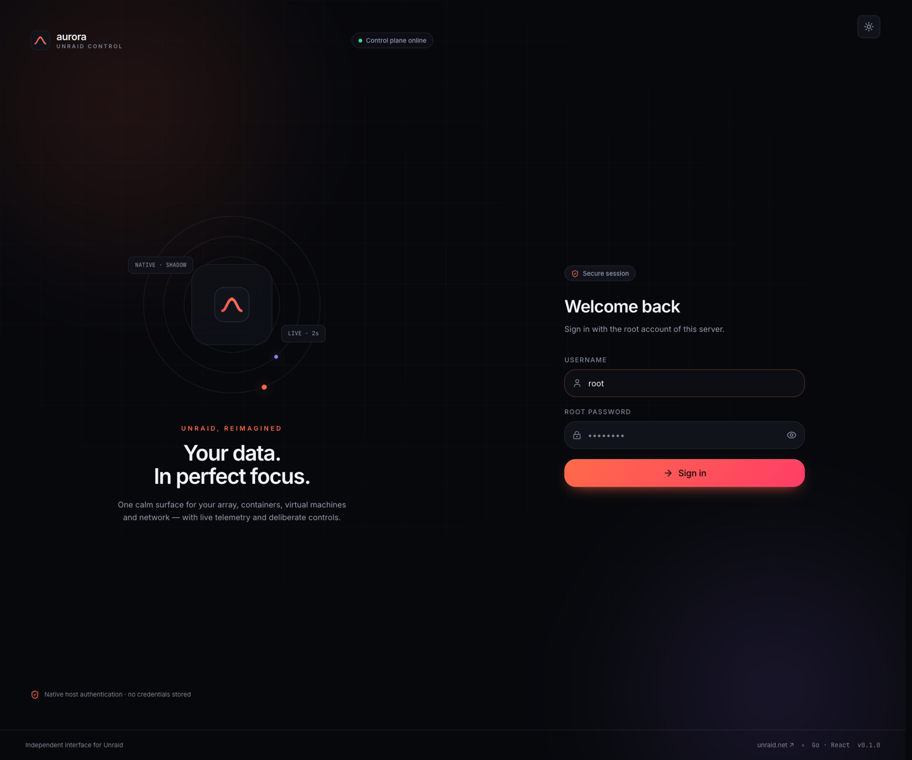

- Aurora has **no local account database**. Credentials are checked against the host's
  `/etc/shadow` through `getent shadow root` / `/etc/shadow`.
- Only the native `root` account can sign in.
- Sessions are HMAC-signed, `HttpOnly`, and protected by origin checks and a custom request header.
- The UI is served over **HTTPS only** using the Unraid certificate bundle
  (`/boot/config/ssl/certs/<server>_unraid_bundle.pem`), with TLS 1.2 minimum.
- Three failed attempts trigger a temporary lockout.

---

## 2. Navigation and command palette

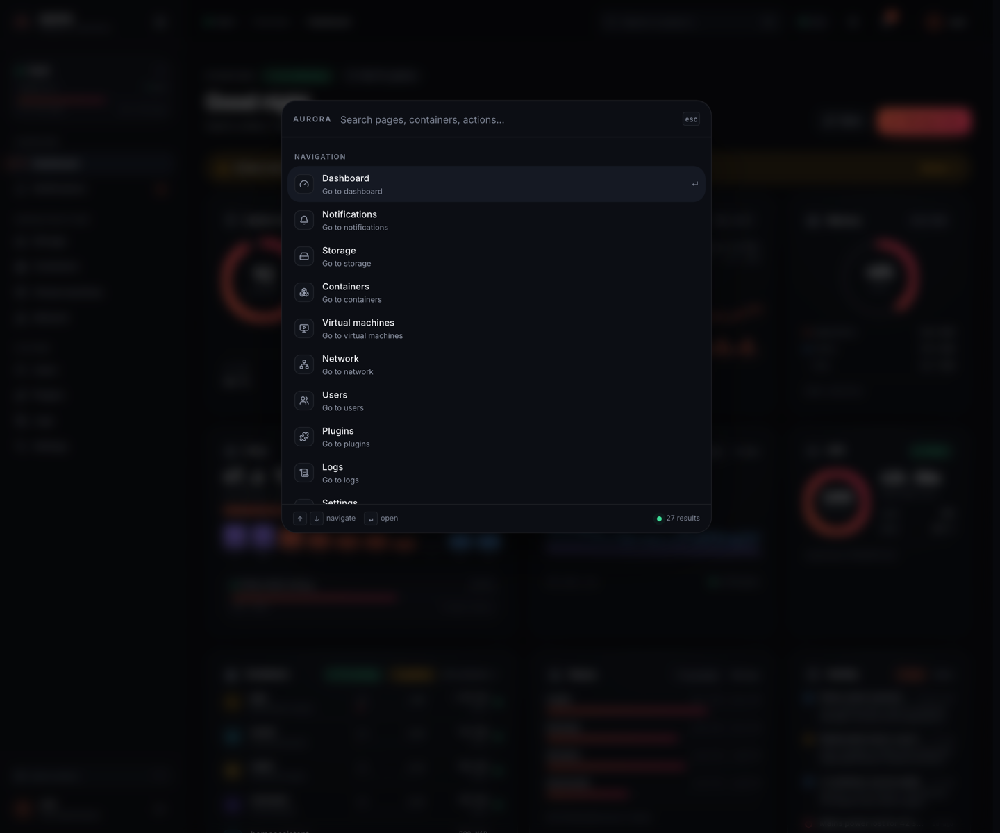

- The sidebar groups pages into **Overview**, **Infrastructure** and **System**.
- It can be collapsed; the choice is stored in the browser.
- The top bar contains the global search ("Search or jump to…"), theme toggle, notifications and
  account menu.
- The **command palette** (`⌘K` / `Ctrl+K`, or `/`) searches:
  - pages and global actions,
  - containers: name, state, image, network and IP,
  - virtual machines: name, state and operating system.
- Selecting a container opens its details drawer; selecting a VM opens its drawer.
- **Container actions** and **VM actions** groups expose start/restart/stop shortcuts.

---

## 3. Dashboard

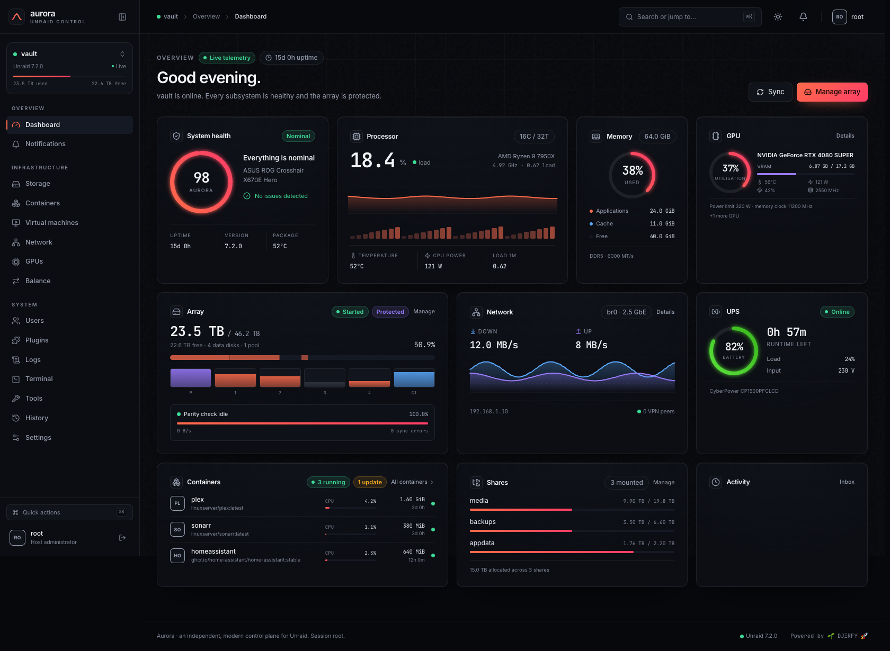

The dashboard is the operational summary of the host:

- **Health score** and detected issues.
- **CPU** usage, temperature and per-core load.
- **Memory** used/available.
- **Array** state, capacity and protection.
- **Network** throughput and interface state.
- **Workloads**: running containers and VMs.
- **UPS** state when `apcupsd` is present.
- **Recent notifications** and quick links to the relevant pages.

All widgets refresh automatically (default 5 seconds, configurable in Settings) and are driven by
live SSE metrics.

---

## 4. Notifications

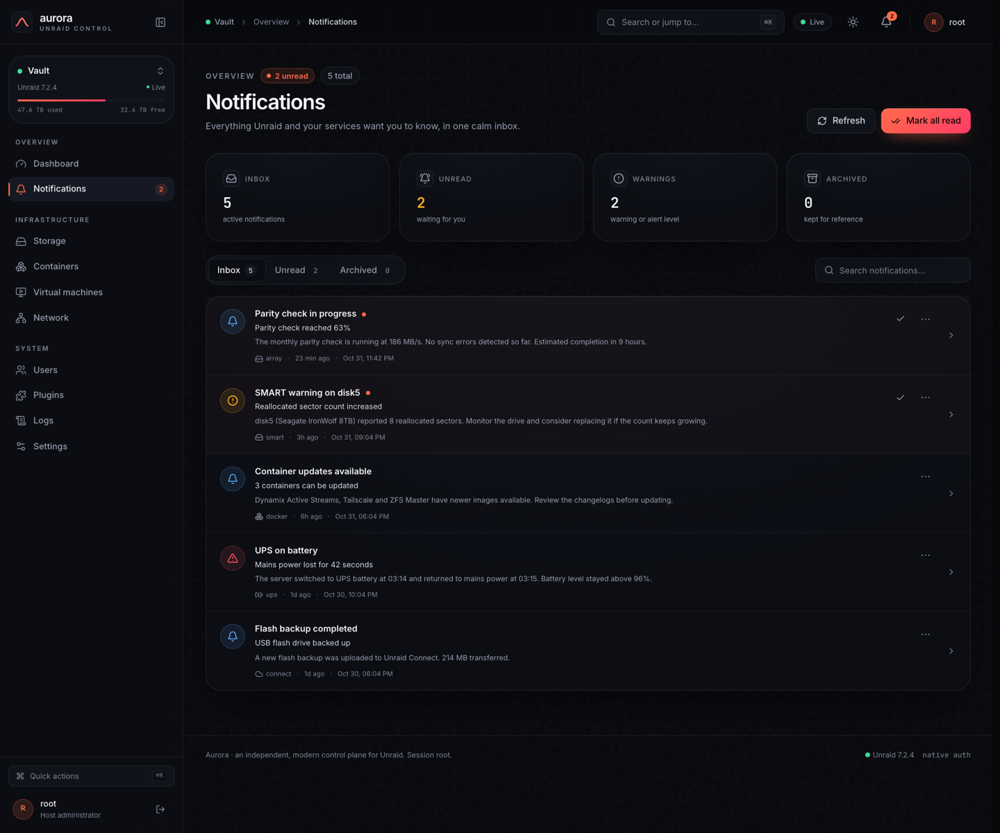

- Inbox and archive, unread/archived filters and severity badges.
- Text search across titles, subjects and descriptions.
- **Acknowledge** moves a notification to the archive.
- **Acknowledge all** clears the unread inbox.
- The top bar shows the unread count and a short preview menu.

---

## 5. Storage

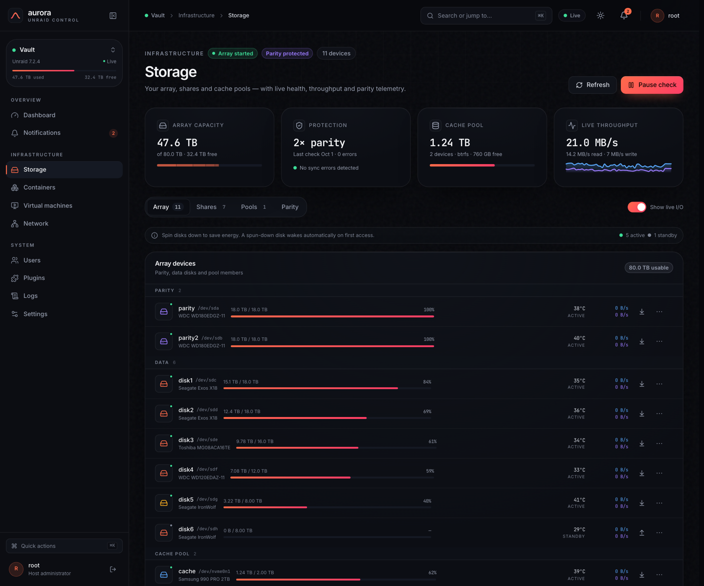

Storage is organised in tabs: **Array**, **Shares**, **Pools**, **Parity** and **Location**.

### 5.1 Array

- Array state, protection level, total/used/free capacity and live throughput.
- **Start array** / **Stop array** with confirmation.
- Start supports:
  - no key,
  - **passphrase** (printable ASCII, encoded like the official webGUI),
  - **keyfile** upload (written to Unraid's configured `luksKeyfile`),
  - **maintenance mode**.
- Disk groups: parity, data, cache pool and boot device.
- Spin up/down per disk, with live read/write throughput.
- SMART warnings are surfaced on the disk row.

### 5.2 Location

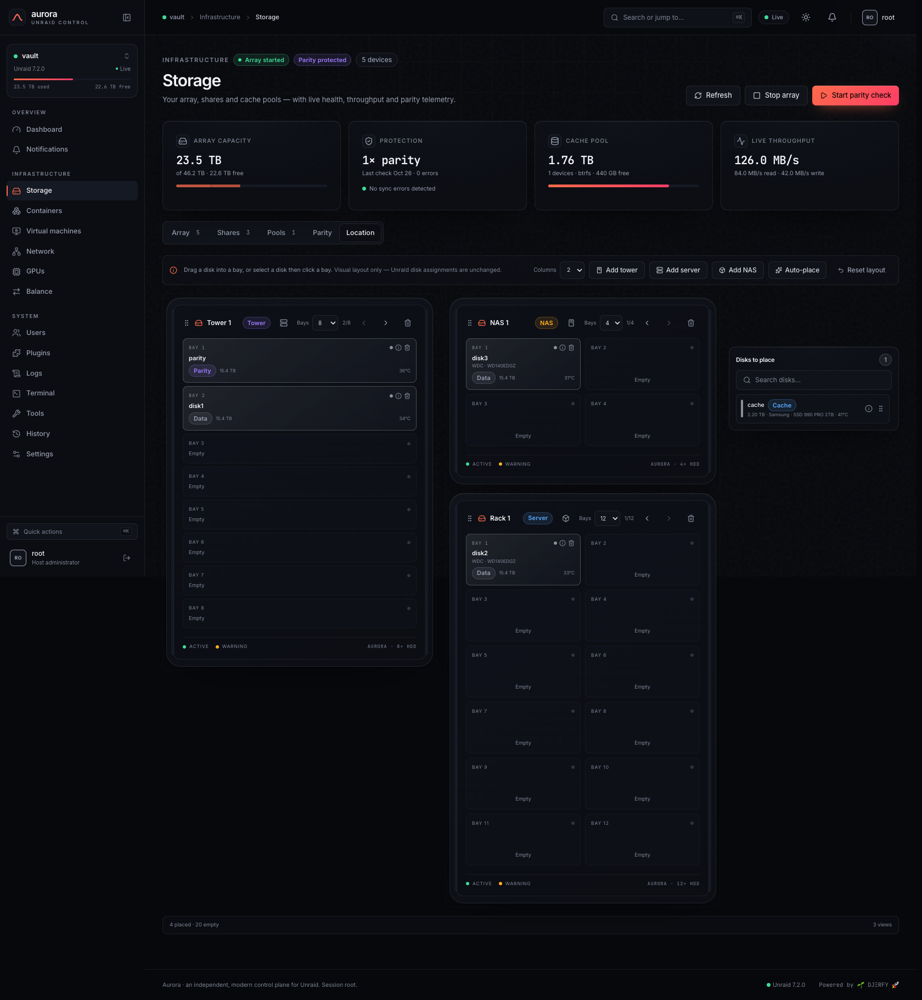

Location is a visual canvas of the physical chassis. It is server-specific and never changes Unraid's
disk assignments.

- The **Add** menu creates a **Server**, **Desktop** or **NAS** 3D-style chassis panel.
- Panels snap to a **12-column grid**, cannot overlap, and can be dragged anywhere on the board.
- Each panel has a rename field, a delete action and **Auto-arrange** support.
- Hover a panel to reveal its **edge and corner handles**, then drag to resize it freely on the grid.
- Resizing never overlaps another panel: the drag stops at the first occupied cell.
- On narrow screens the board becomes a stacked list while keeping saved positions.
- Inside each chassis, add and reorder **horizontal sections** (Data, Cache, Parity, custom).
- A section has a name, colour, media type (**Any / HDD / SSD / NVMe**), rows and columns.
- A media mismatch is allowed but shows a warning on the section and affected disk.
- Drag a disk from **Disks to place** into a bay, or select a disk then click an empty bay.
- Drag disks between bays, sections and chassis; removing a section returns its disks to the list.
- **Auto-place** fills the sections in reading order, preferring disks matching the section media, then
  parity → data → cache.
- **Reset layout** clears assignments but keeps panels and sections.
- Each assigned bay and tray card is compact and shows the essentials: name, brand + model, serial,
  size and temperature. A drive illustration hints at the physical media (HDD, SSD or NVMe), and
  the info button opens the existing disk drawer.
- **Disks to place** contains every unassigned drive with the same identity details.
- The v2 layout is stored in `$AURORA_CONFIG_DIR/storage-layout.json` (default
  `/boot/config/aurora`) and the previous column-based format is migrated automatically.

### 5.3 Disks and SMART

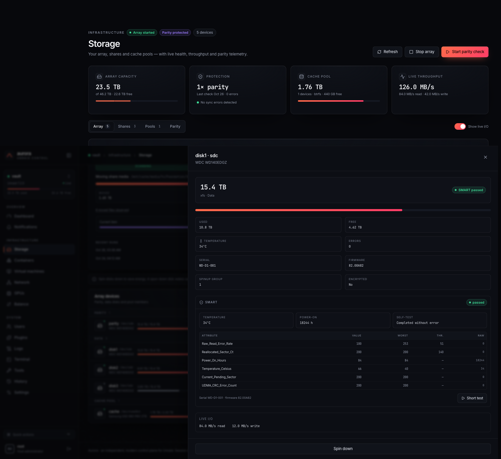

Open a disk to see:

- capacity, filesystem, used/free, temperature, error count;
- serial number, firmware, spin-up group, encryption;
- live I/O;
- **SMART** section with health, temperature, power-on hours, self-test status and the ATA/NVMe
  attribute table (value, worst, threshold, raw, failing rows highlighted);
- **Short test** button (`smartctl -t short`).

If `smartctl` is missing or the disk is in standby, the drawer explains why data is unavailable.

### 5.4 Shares

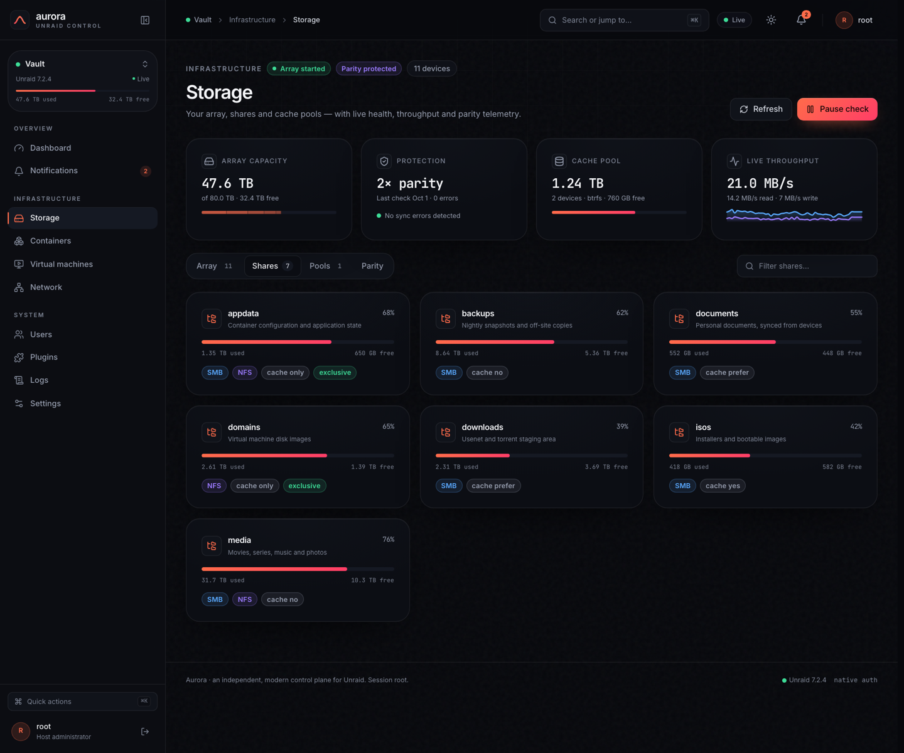

Share cards show usage, SMB/NFS state, cache mode and allocation.

**Create a share**

1. Open **Storage → Shares**.
2. Click **New share** (top right).
3. Fill the settings below and click **Apply changes**.

**Rename a share**

1. Click the share card.
2. Click **Edit settings**.
3. Change the **Name** field and apply. Collisions are rejected; data stays on disk.

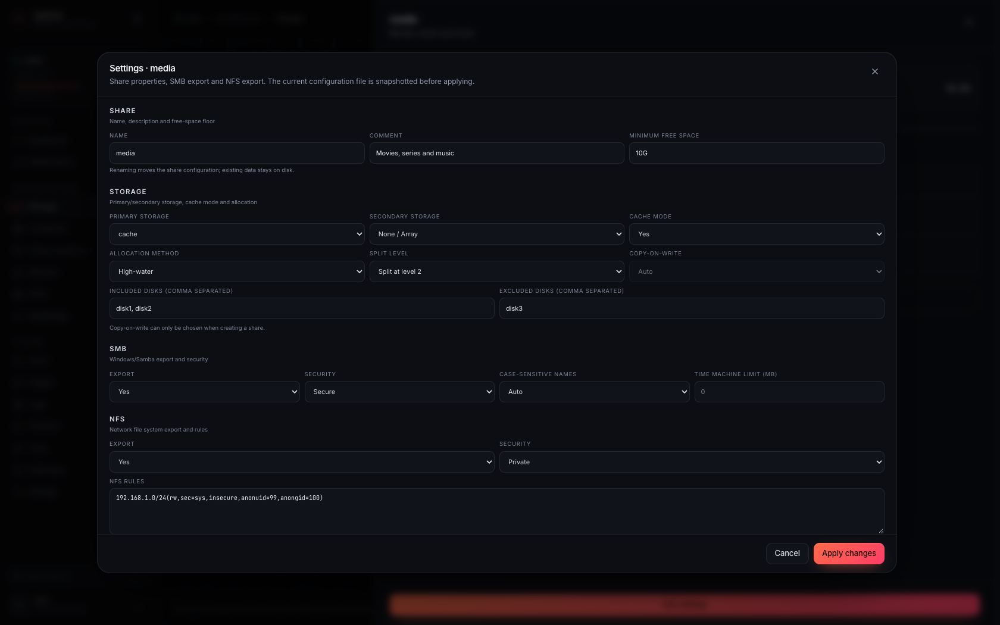

Share settings:

| Section | Options |
|---|---|
| Share | Name, comment, minimum free space (`0`, `10G`, `500M`…) |
| Storage | Primary storage (Array/pool), secondary storage, cache mode (`No`, `Yes`, `Prefer`, `Only`), allocation method (`High-water`, `Fill-up`, `Most-free`), split level, included/excluded disks, copy-on-write (read-only for existing shares) |
| SMB | Export (`No`, `Yes`, hidden, Time Machine variants), security (`Public`, `Secure`, `Private`), case-sensitive names, Time Machine size limit |
| NFS | Export (`No`, `Yes`), security (`Public`, `Secure`, `Private`), host rules when private |

Every change is sent through the same emhttpd commands as the official webGUI. The share
configuration file is snapshotted before the command and recorded in **Historique**, so it can be
reviewed or rolled back.

### 5.5 Pools

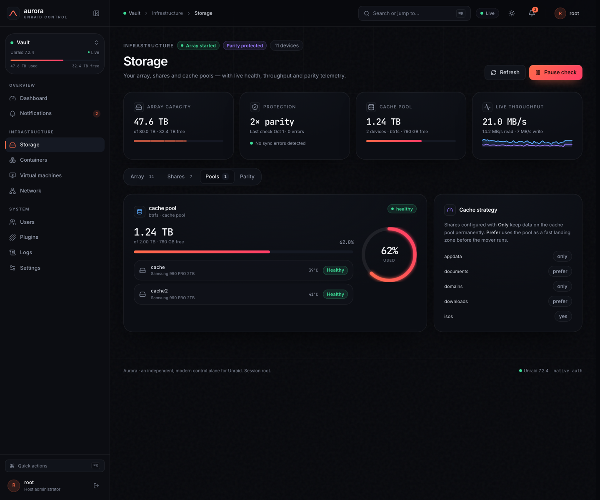

- Pool capacity, usage, filesystem, devices and health.
- Cache/boot classification.
- Pool membership is derived from the live disk inventory.

### 5.6 Parity

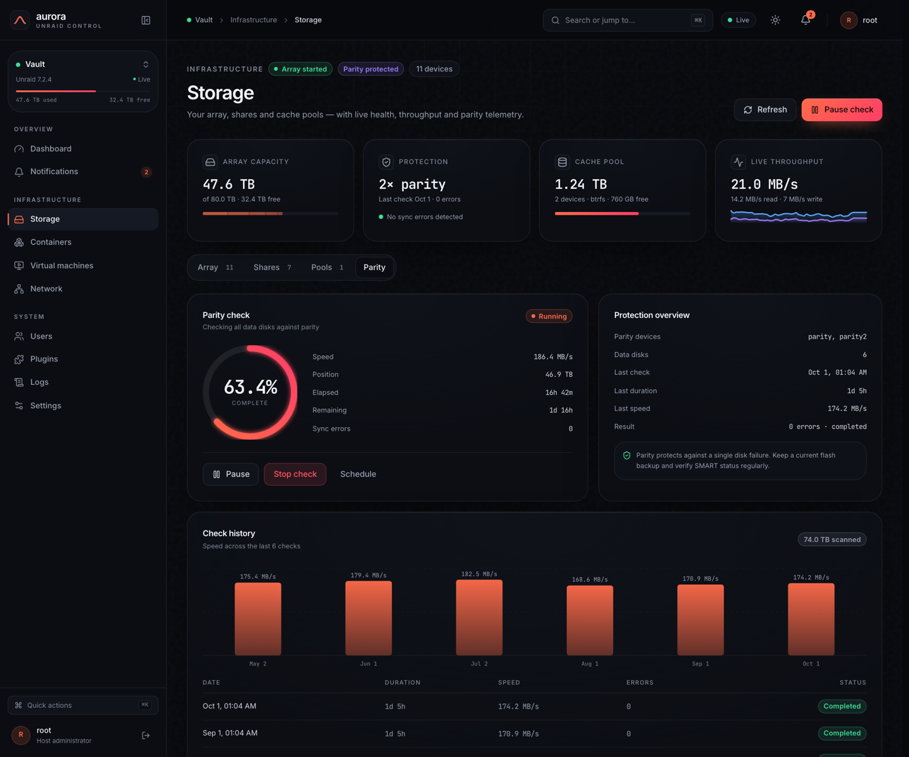

- Current parity check progress, speed, elapsed time, ETA and errors.
- Start, pause, resume and cancel.
- Historical checks with duration, speed, status and error count.

### 5.7 Mover

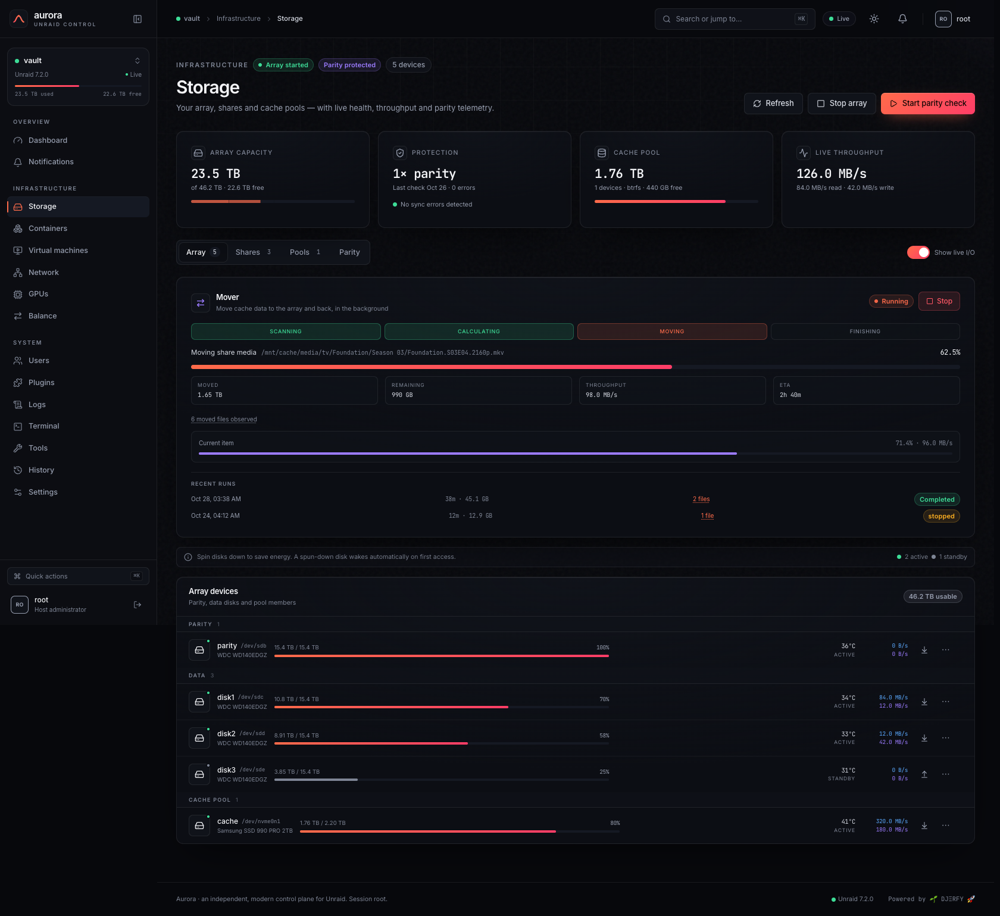

- Start/stop the official mover in the background.
- Live phases: **Recherche → Calculs → Déplacement → Finalisation**.
- Current share/action and file, global and per-share progress, throughput and ETA.
- Files observed during the run (best effort, sampled from `mover.ini`).
- A collapsible **Recent runs** list keeps the last **10** mover runs, with duration, moved bytes and the file list.
- Runs started from Aurora capture the mover's own output, so the file list works even when Unraid's
  optional byte-progress setting is disabled; byte progress still follows `mover.ini`.

### 5.8 Rebalancing

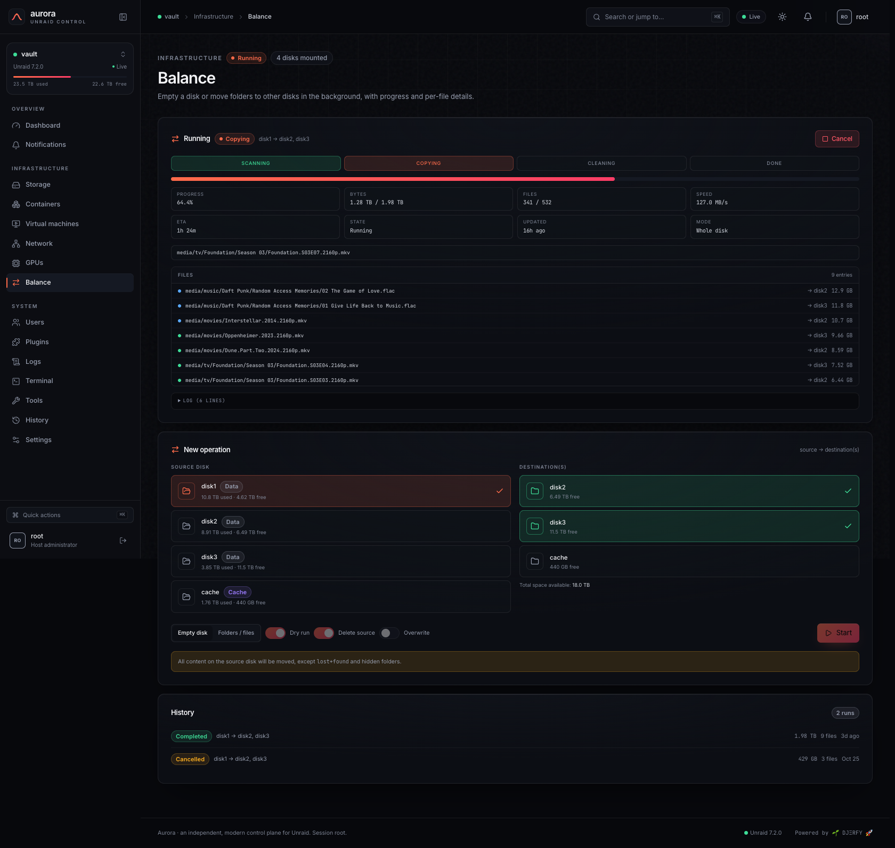

Use this page to empty a disk before replacing it, or to move selected folders/files.

- **Source** and **Destination(s)** are detected from mounted `/mnt` entries.
- Two modes:
  - **Vider le disque**: moves everything except `lost+found` and hidden folders;
  - **Dossiers / fichiers**: browse the source disk, select folders or files.
- Options:
  - **Dry run** (default): scans and plans without writing or deleting;
  - **Supprimer la source**: deletes each source file only after a verified copy;
  - **Écraser**: overwrite existing destination files (off by default).
- Pipeline: **copy → size verification → source deletion**. Symlinks, hardlinks, permissions,
  ownership and timestamps are preserved.
- Live details: phase, bytes, files, speed, ETA, current path, per-file status
  (moved/planned/skipped/failed), errors and a journal.
- **Cancel** stops after the current file. The last 20 runs are kept in
  `$AURORA_CONFIG_DIR/balance-history.json` and shown on the page.

---

## 6. Containers

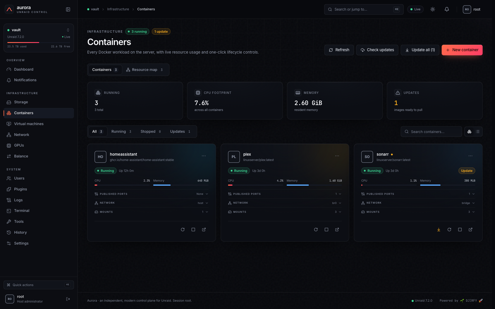

### Views and columns

- Grid or list view; the choice persists across refreshes.
- List columns: name, image, network, IP, mounts, state, CPU, memory, uptime and actions.
- The **Mounts** column lists every bind mount with its container path and `ro`/`rw` access;
  hover a row to see the full host → container mapping.
- Filters: **All**, **Running**, **Stopped**, **Updates**.
- Search covers name, image, network, IP and category.
- Cards show a coloured halo, live CPU/RAM, uptime, and collapsible sections for published ports, network/IP and mounts.

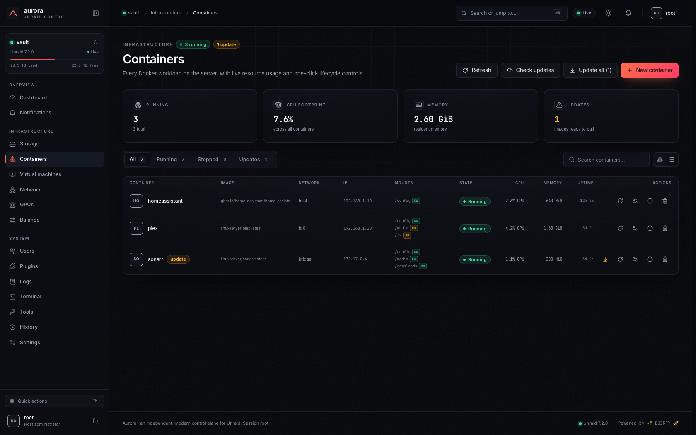

### Resource map

The **Resource map** tab turns the running containers into a live scatter map:

- **Compute**: CPU on the X axis, memory on the Y axis, bubble size by memory.
- **Network**: receive and transmit rates (bytes/s) on the axes.
- **Disk I/O**: read and write rates (bytes/s) on the axes.
- Bubble colour identifies the container in every view.
- **Top consumers** ranks the six busiest containers for the selected view.
- The map fills the available width and can be resized vertically with the handle in its bottom-right
  corner; the chosen height is remembered in the browser.
- Hovering a bubble shows the container, image, CPU, memory, network RX/TX and disk read/write rates;
  clicking it opens the container drawer.

Rates are derived from Docker's cumulative counters between two polls, so the first sample of a
new container starts at zero and fills in on the next refresh.

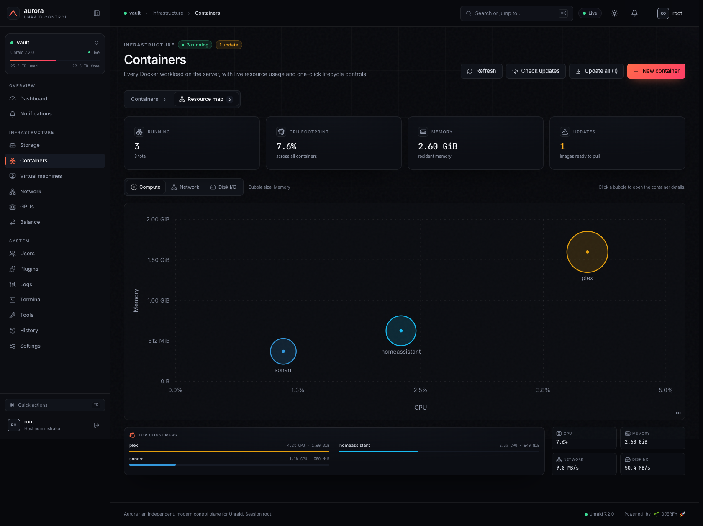

### Details

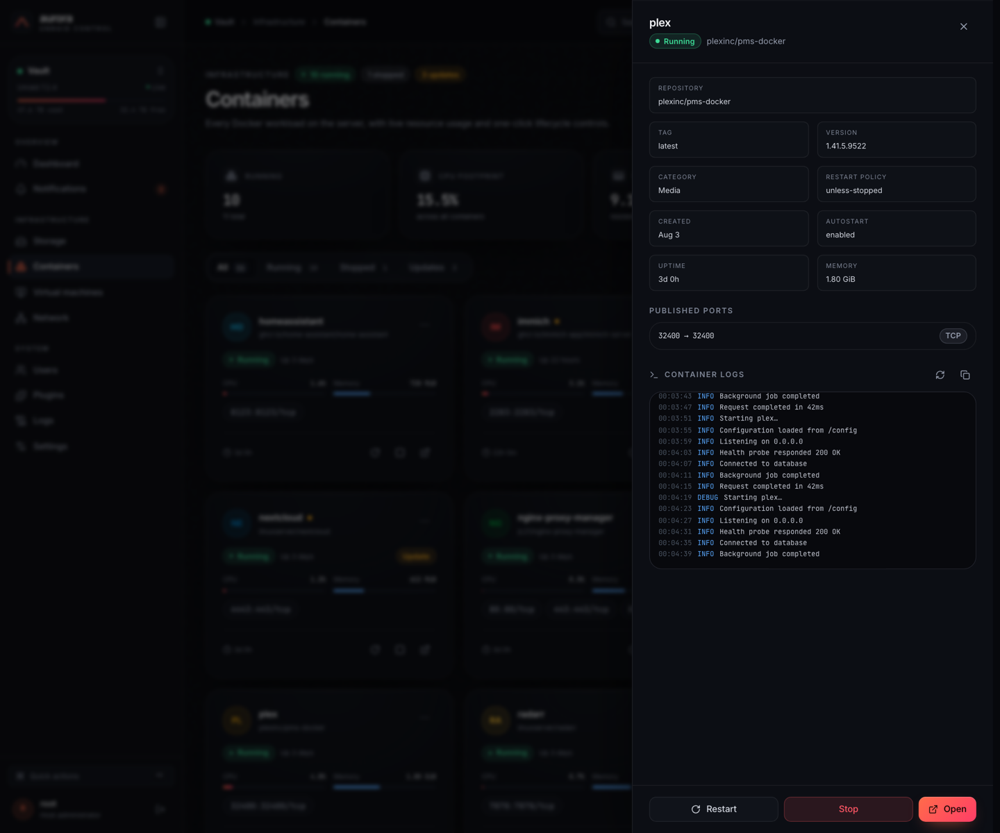

The drawer shows the real icon, state, image, repository/tag, category, restart policy, network, IP,
uptime, memory, published ports and live container logs with reload/copy.

Actions: start, restart, stop, open WebUI, update image, edit settings, remove.

### Settings editor

Edit paths (bind mounts, read-only), published ports, environment variables and restart policy.
Applying stops and recreates the container with rollback on failure. The Unraid XML template is
synchronised and the previous template is stored in **Historique**.

### Create a container

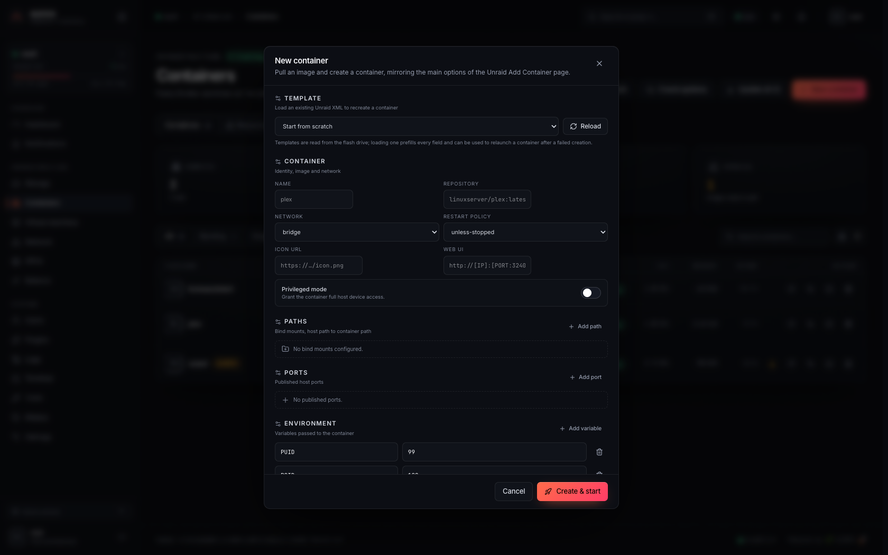

- **New container** opens a form with:
  - optional template picker (existing `my-*.xml` from the flash drive),
  - name, repository/image, network (bridge/host/none/custom), restart policy,
  - icon URL, WebUI, privileged mode,
  - paths, ports, environment (`PUID`/`PGID`/`UMASK` prefilled).
- The image is pulled when missing; the container is created and started.
- Templates prefill every field and can be used to relaunch a container after a failed creation.

### Image updates

- **Check updates** compares local repository digests with registry manifests (Docker Hub, GHCR,
  private registries with `~/.docker/config.json` credentials).
- Badges appear on cards, list rows, the Updates tab and the dashboard.
- Updating pulls the image and recreates the container with its current settings; the UI streams
  each step (pull progress, stop, recreate, start, cleanup) in real time.
- **Update all** processes every outdated container sequentially.

### Autostart and removal

- **Start with the array** toggles Unraid's `/var/lib/docker/unraid-autostart` entry.
- **Remove container** asks for confirmation; bind mounts and appdata stay on disk.

---

## 7. Virtual machines

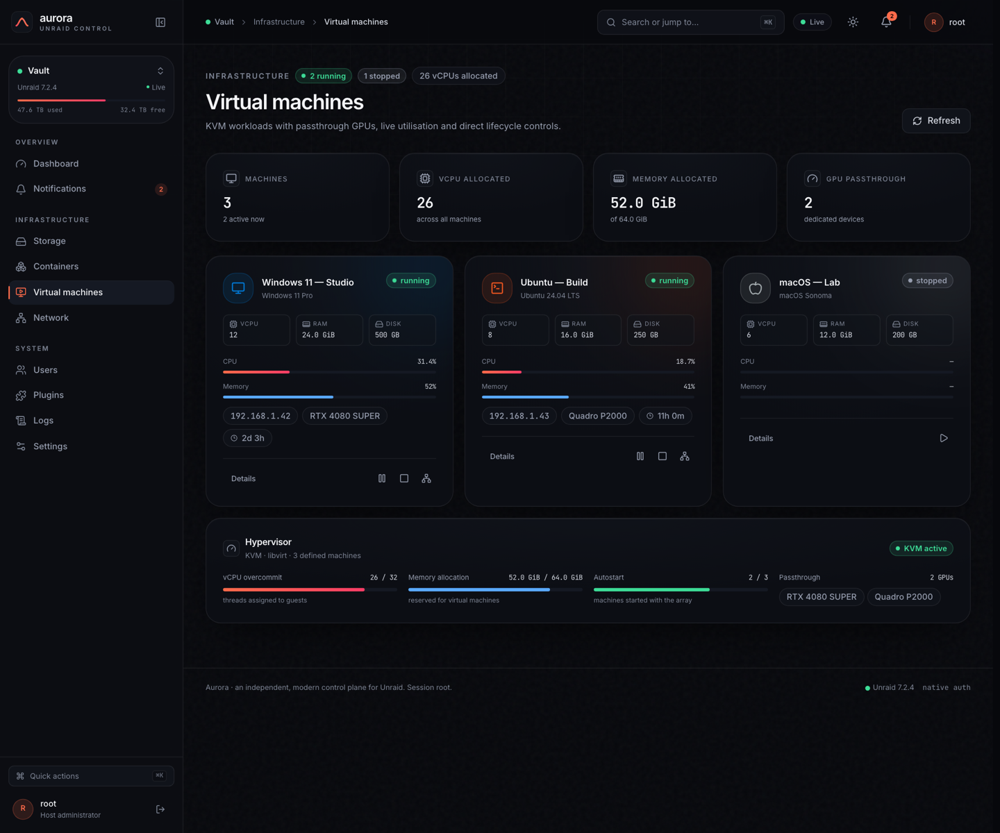

- Grid or list view, persisted across refreshes.
- Cards and rows show state, OS, vCPU, memory, CPU/RAM usage, IP, primary GPU and uptime.

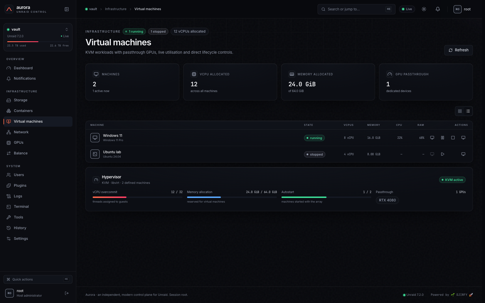
- Lifecycle: start, suspend/resume, shut down.
- **Autostart** toggle uses libvirt `virsh autostart`.
- **XML** opens the libvirt domain definition read-only, with copy-to-clipboard.
- **Console** opens the VNC/SPICE console.

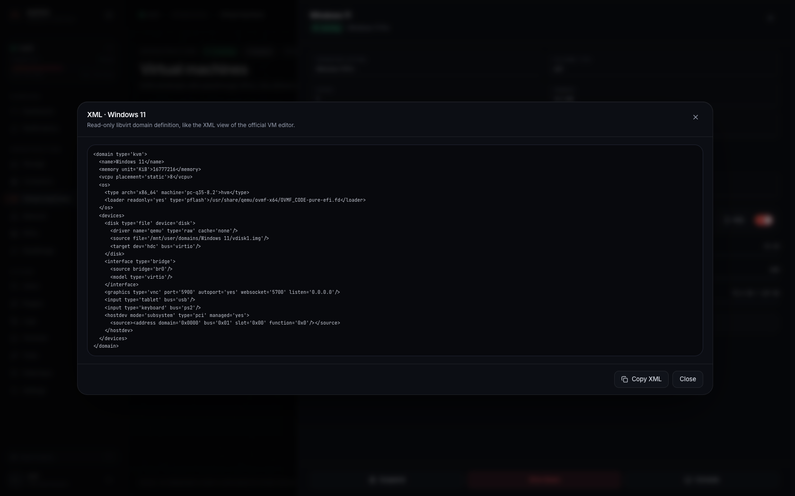

### Details

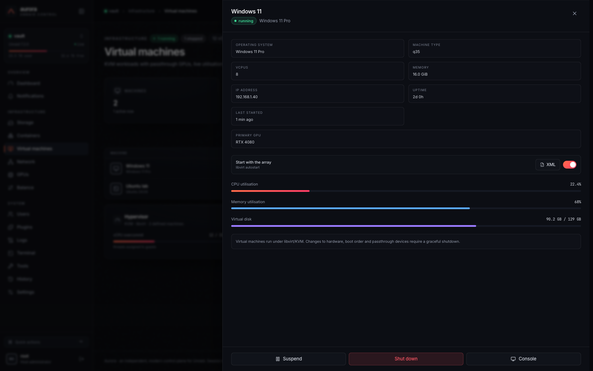

The drawer shows OS, machine type, vCPUs, memory, IP, uptime, last start, primary GPU, CPU/memory/disk
utilisation, autostart and actions.

### Console

- Full-screen **VNC** viewer over an authenticated WebSocket proxy.
- The upstream port comes from the domain XML; no client-supplied target is accepted.
- **New window** opens a standalone console page.
- Keyboard input is captured at document level and can be sent via **Ctrl+Alt+Del** for Windows
  guests.
- If keystrokes do not reach a guest, see the tracked issue:
  <https://github.com/djerfy/unraid-aurora/issues/1>.

---

## 8. Network

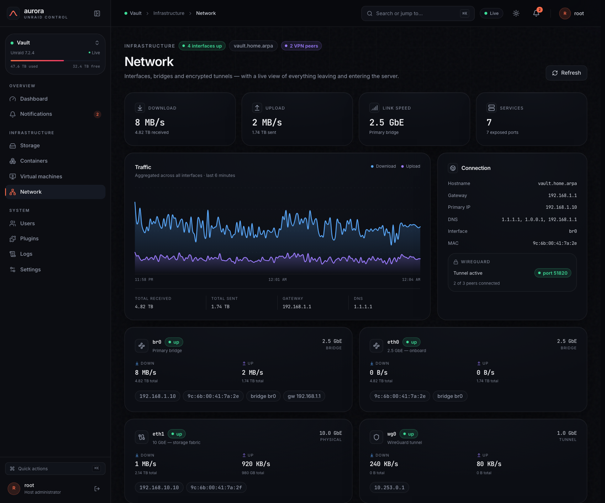

- Interfaces, MAC, IPv4/IPv6, speed, state and live RX/TX.
- Gateway, DNS and domain.
- WireGuard status and peers.
- Listening services with protocol, status and direct links.
- Traffic chart.

Network configuration is currently **read-only**; changing interfaces, bonding, bridges, VLANs or
WireGuard remains on the roadmap.

---

## 9. GPUs

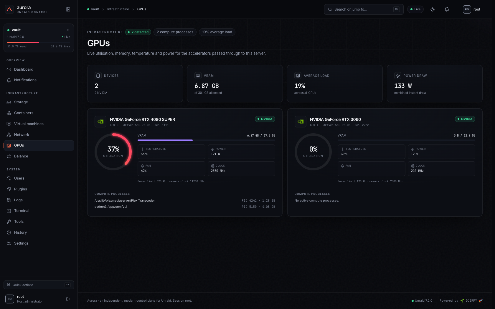

- NVIDIA through `nvidia-smi`, AMD/Radeon through `rocm-smi`.
- Per GPU: utilisation, VRAM used/total, temperature, power draw, power limit, fan, core and memory
  clocks.
- Active compute processes with PID and memory.
- Vendor logo and neutral icon frame.
- Empty state explains how to install the Nvidia Driver plugin.

---

## 10. Users

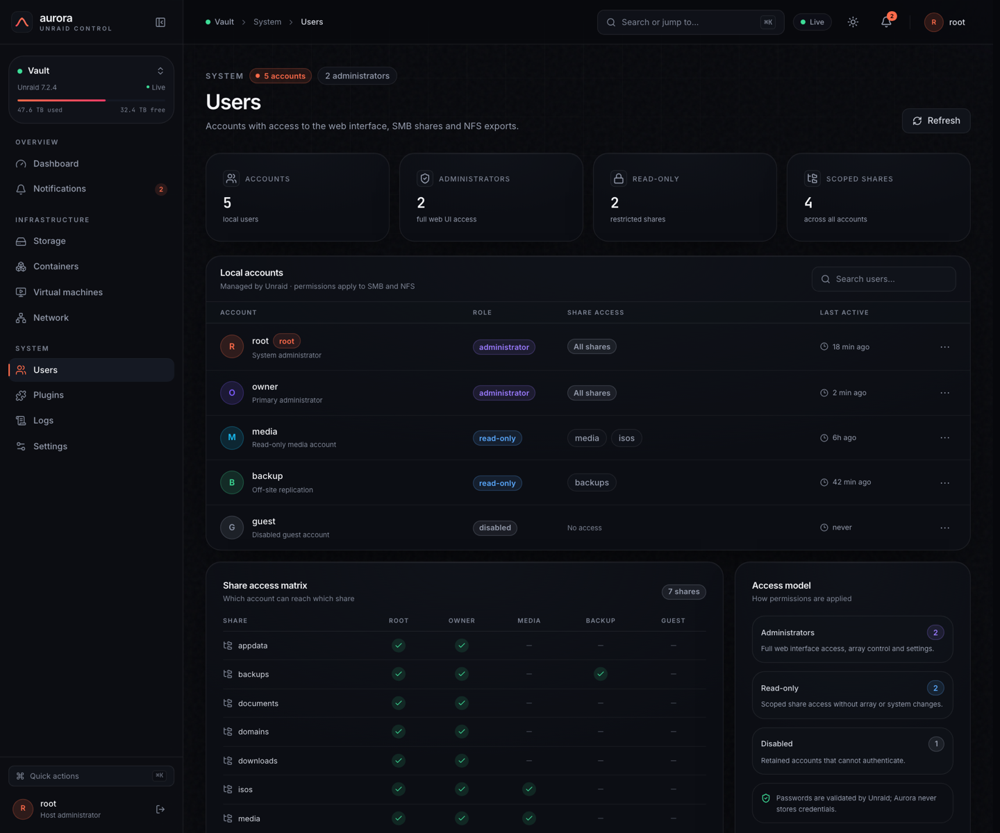

- Account list with role, UID, last activity and share access.
- **Add user** creates the Unix account, Samba credentials and share access through emhttpd.
- **Edit** changes the description.
- **Change password** sends the new password once to emhttpd (base64), never stores it.
- **Delete** removes a non-root account after confirmation.
- Avatars are read from `/boot/config/plugins/dynamix/users/<name>.png`.
- Passwords are never logged or persisted by Aurora.

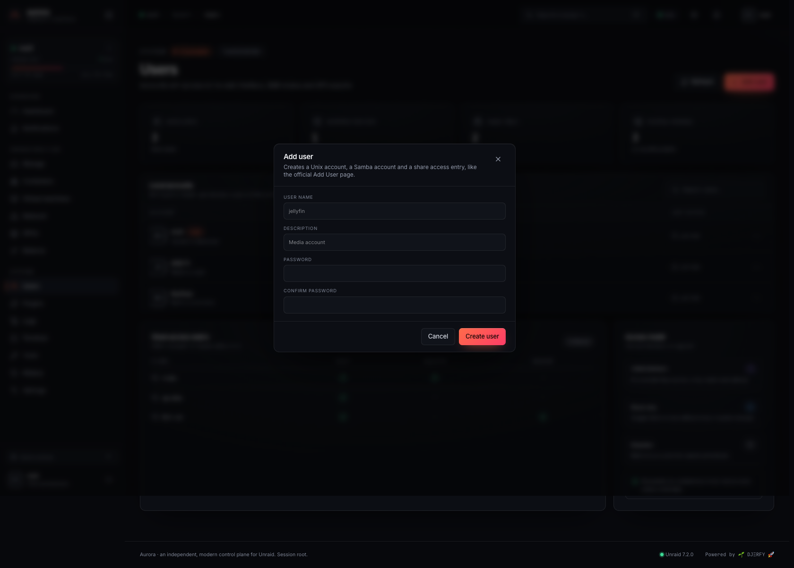

---

## 11. Plugins

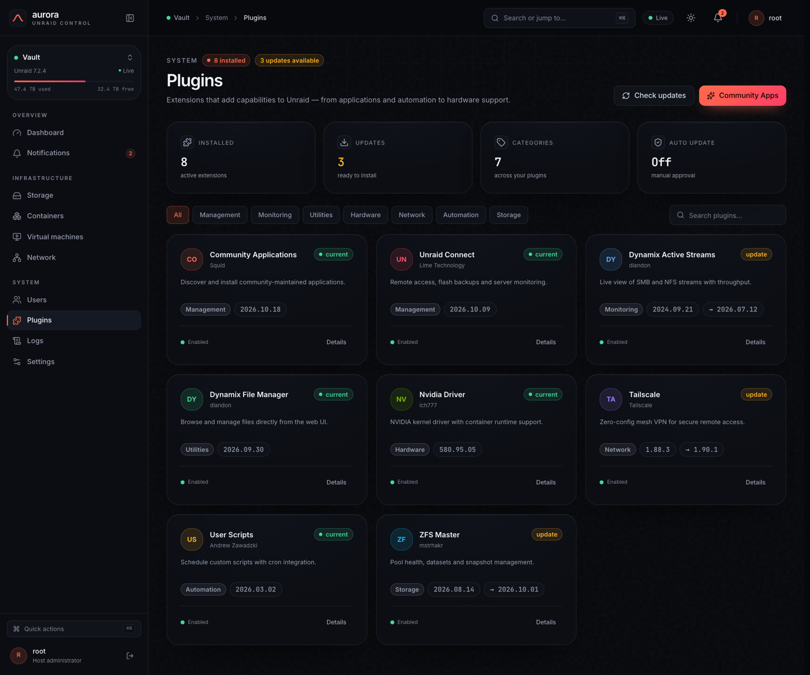

- Real `.plg` metadata: name, version, author, category, description.
- **Check updates** downloads each plugin definition and compares versions.
- **Update** runs the official plugin manager and streams its output.
- **Install plugin** accepts an `.plg` URL; **Remove plugin** deletes it through the plugin manager.
- All operations show a live output modal and require explicit confirmation.
- Community Applications opens in a new tab.

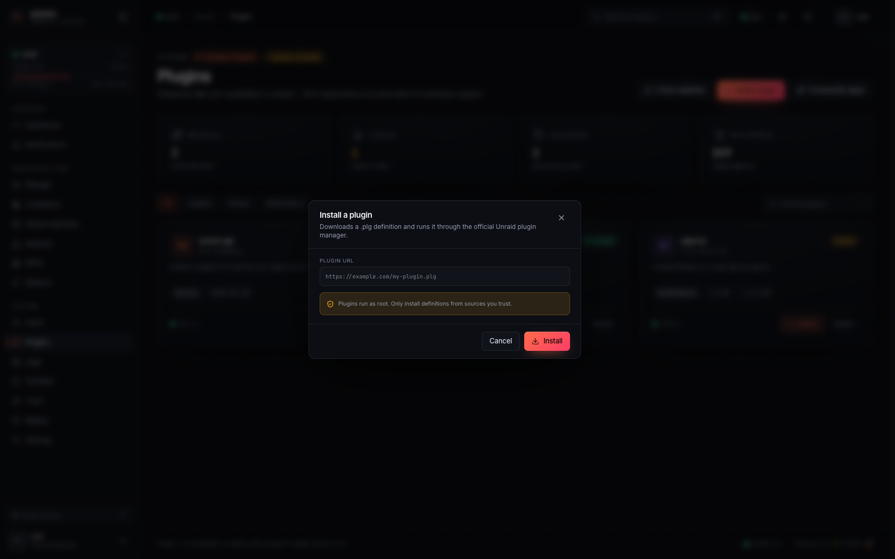

---

## 12. Logs

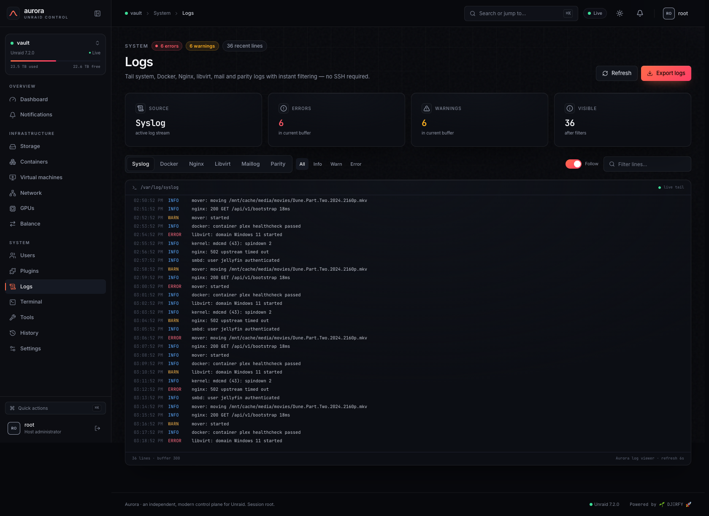

Sources:

- **Syslog** (`/var/log/syslog`)
- **Docker** (`/var/log/docker.log`)
- **Nginx** (`/var/log/nginx/*.log`, merged with file prefixes)
- **Libvirt** (`/var/log/libvirt/libvirtd.log`, fallback `libvirt.log`)
- **Maillog** (`/var/log/maillog`, fallback `mail.log`)
- **Parity** (`/var/log/parity.log`)

Controls: level filter (all/info/warn/error), text filter, follow/auto-scroll, export to file.
Missing logs show an explicit message with a retry button instead of a generic error.

---

## 13. Terminal

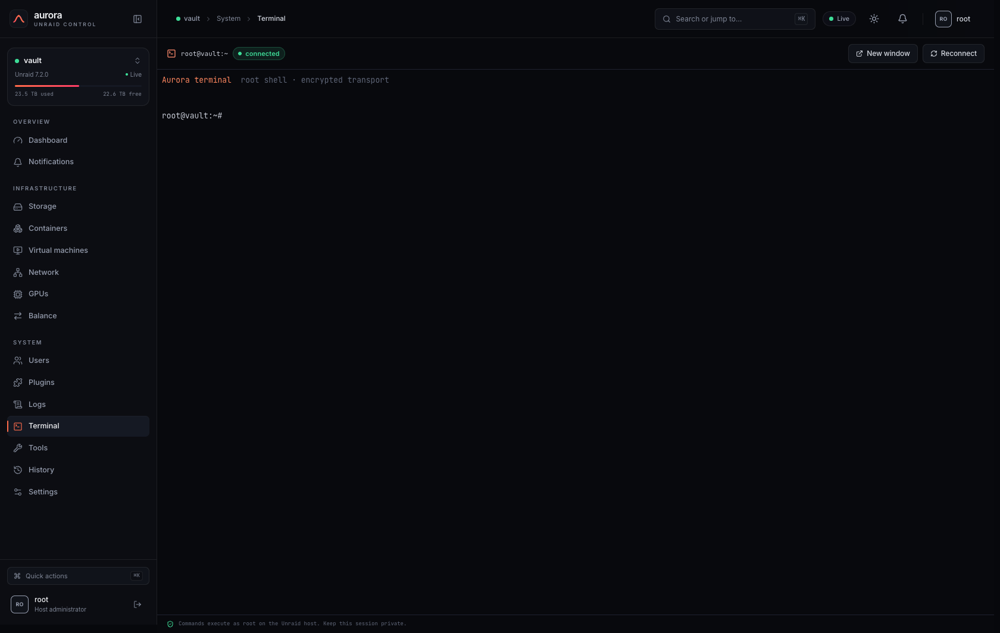

- Interactive **root shell** over an authenticated WebSocket + PTY.
- Opens the authenticated account's default shell from `/etc/passwd` (login profile), with `/bin/sh` as fallback.
- Full-page layout, dark theme, no fake window chrome.
- **New window** opens the standalone terminal page.
- Keyboard shortcuts are not intercepted by Aurora while the terminal is focused.
- Commands run as root on the host: treat the session as host-level credentials.

---

## 14. Tools

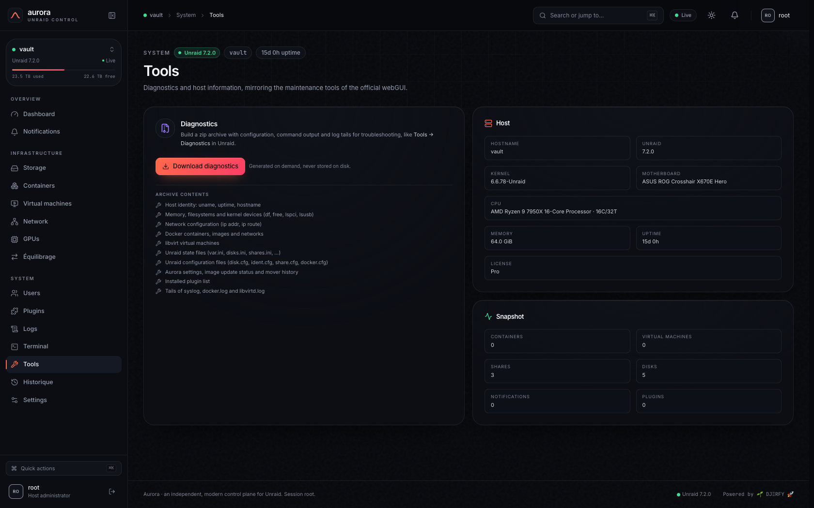

- **Download diagnostics** builds a ZIP on demand:
  - host identity (`uname`, `uptime`, hostname);
  - `df`, `free`, `lspci -nnk`, `lsusb`, `ip addr`, `ip route`;
  - Docker containers/images/networks and libvirt VMs;
  - Unraid state files (`var.ini`, `disks.ini`, `shares.ini`, …);
  - Unraid config files (`disk.cfg`, `ident.cfg`, `share.cfg`, `docker.cfg`);
  - Aurora settings, image update status, mover and balance history;
  - installed plugin list;
  - tails of syslog, docker and libvirt logs.
- Host summary and snapshot counters.
- Nothing is stored server-side; the archive is generated per request.

---

## 15. Historique (configuration history)

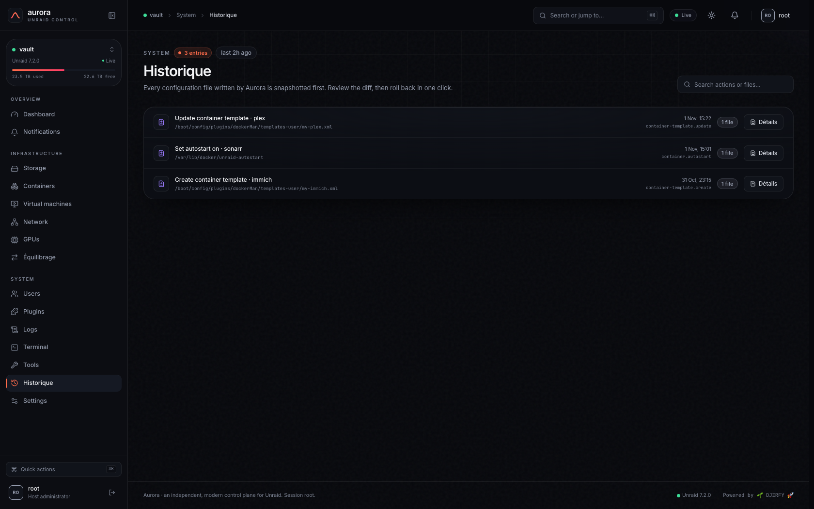

Every file-backed configuration change made by Aurora is snapshotted before writing:

- container XML templates,
- Docker autostart list,
- share configuration files (create/rename/edit),
- any future file-backed setting using the same helper.

Each entry shows the action, description, affected files, previous size and a **Différence** view.
**Rollback** restores the previous contents; the current state is snapshotted first, so a rollback
can itself be reverted.

- Storage: `$AURORA_CONFIG_DIR/config-history/<id>/` (`meta.json`, `files/`).
- Limit: 200 entries.
- Some emhttpd-managed changes (shares, users) may require a service reload or restart before the
  restored file is applied in memory.

---

## 16. Settings

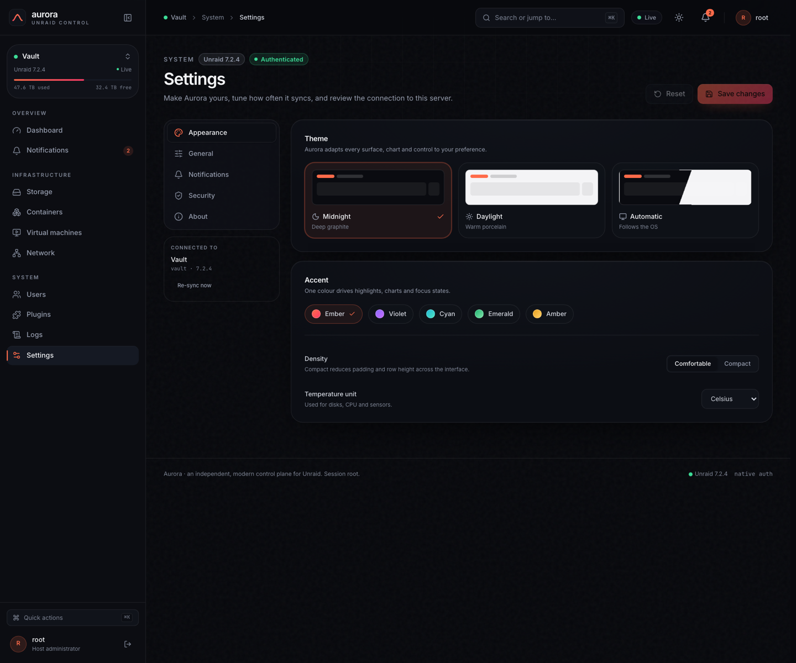

- **Theme**: dark, light, or automatic.
- **Accent**: five palettes.
- **Density**: comfortable or compact.
- **Temperature unit**: Celsius or Fahrenheit.
- **Server display name**.
- **Refresh interval**.
- **Language**: English (default) or French. The switch previews immediately; **Save changes** persists it on the server.
- **Automatic updates**, **anonymous telemetry**, **email alerts**, **push notifications**.
- Session information: account, authentication, HMAC session store, CSRF protection.
- About: Unraid version, kernel, uptime, board, memory, license.

---

## 17. Keyboard shortcuts

| Shortcut | Action |
|---|---|
| `⌘K` / `Ctrl+K` | Open/close the command palette |
| `/` | Open the command palette when not typing |
| `↑` / `↓` | Move through palette results |
| `Enter` | Run the selected command |
| `Esc` | Close overlay/drawer/palette |

Aurora's shortcuts ignore inputs, textareas, selects, contenteditable elements and the terminal/VNC
canvas so they never steal keystrokes from a console.

---

## 18. Safety model and backups

- All mutations are authenticated and CSRF-protected.
- `AURORA_READ_ONLY=1` rejects every mutation at the API layer.
- Destructive container operations use inspect → stop → rename → create → start with rollback.
- Container image updates pull first, then recreate with the current configuration.
- Share/user operations run through **emhttpd** (`/usr/local/sbin/emcmd`), never by editing live
  system databases directly.
- File-backed changes are snapshotted in **Historique** with unified diffs and reversible rollback.
- Rebalancing never deletes a source file before a size-verified copy; **dry run is enabled by
  default**.
- Credentials are read from the host only (shadow, `~/.docker/config.json`) and never written by
  Aurora.

> The Linux binary is distributed without the executable bit on GitHub Releases. Run
> `chmod +x aurora_<version>_linux_amd64` after download.

---

## 19. Troubleshooting

| Symptom | What to check |
|---|---|
| Login fails | Confirm the `root` password works over SSH or the Unraid console; Aurora reads `/etc/shadow`. |
| "Cannot locate the TLS certificate" | Check `/boot/config/ssl/certs/<server>_unraid_bundle.pem` or set `AURORA_TLS_CERT` / `AURORA_TLS_KEY`. |
| A log source returns "unavailable" | The file does not exist on this host (for example `libvirtd.log` or `maillog`); enable the corresponding service logging. |
| Container update check fails | The host needs outbound HTTPS access to the registry; private registries need credentials in `/root/.docker/config.json`. |
| Share/user change is rejected | Validation is strict; check the message and the official webGUI for the same values. |
| VNC keyboard does not reach the guest | Check the VM has a keyboard device and see issue #1. |
| Service logs | Use `-log-file`, `-log-format json` and `-daemon`; see the README for environment variables and flags. |

---

## Further reading

- [README](../README.md) — installation, flags, environment variables, release process.
- [Architecture](ARCHITECTURE.md) — internals, providers, API surface, security.
- [Unraid documentation](https://docs.unraid.net) — host behaviour and configuration reference.
