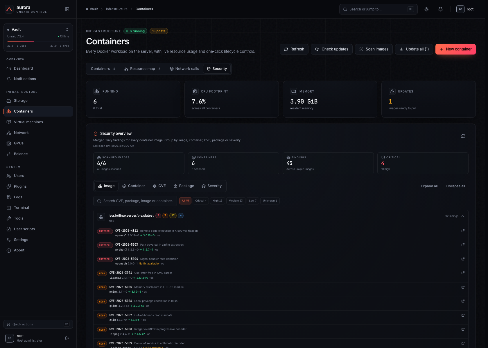
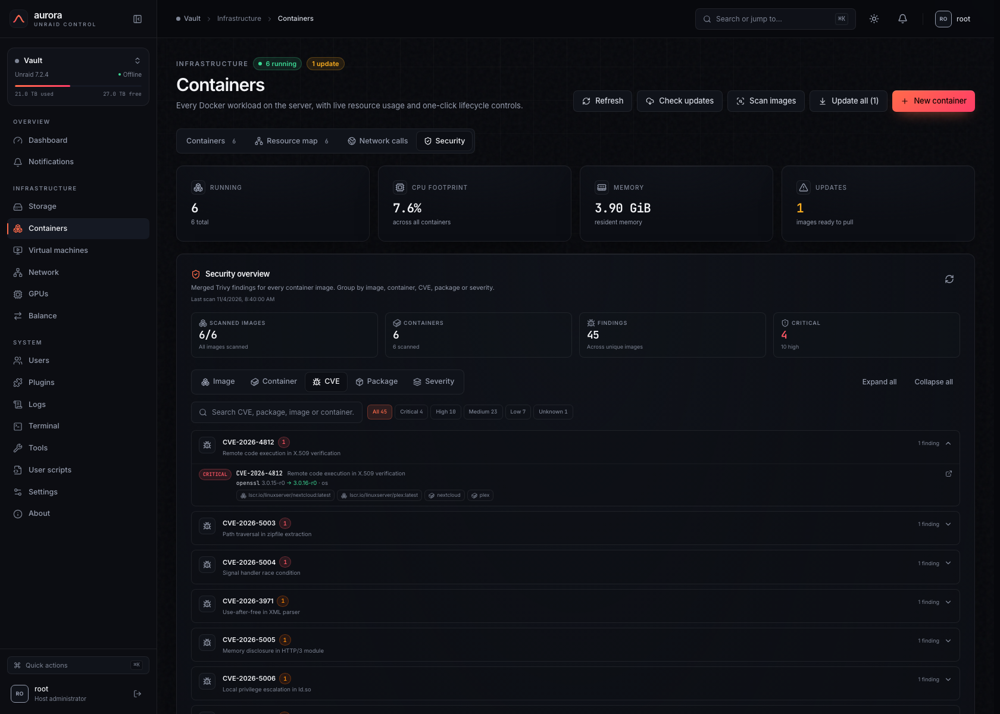
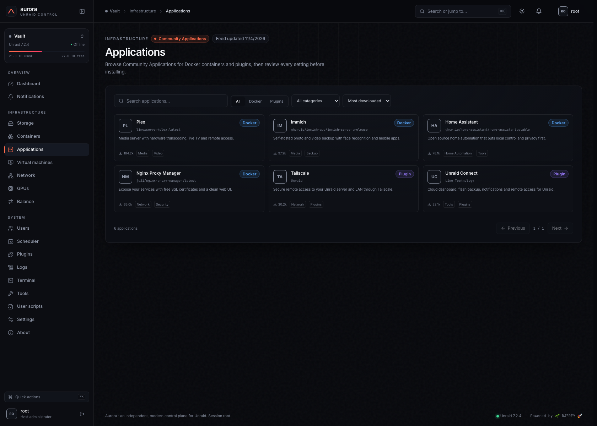
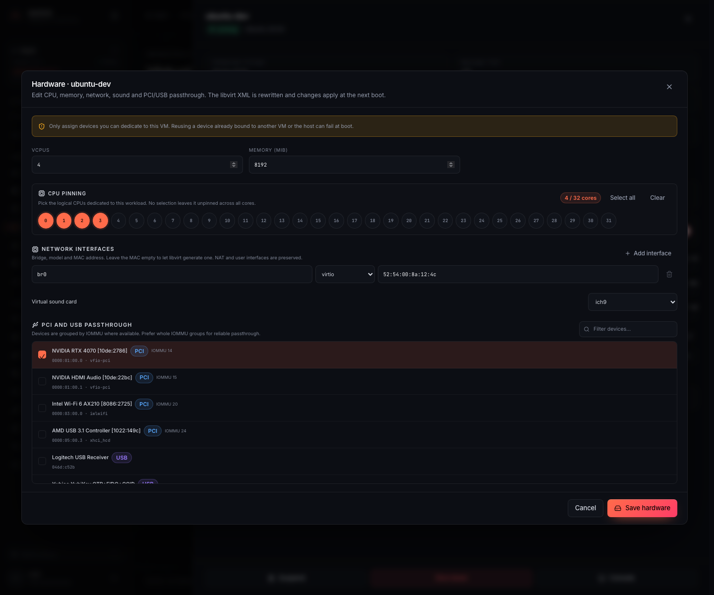
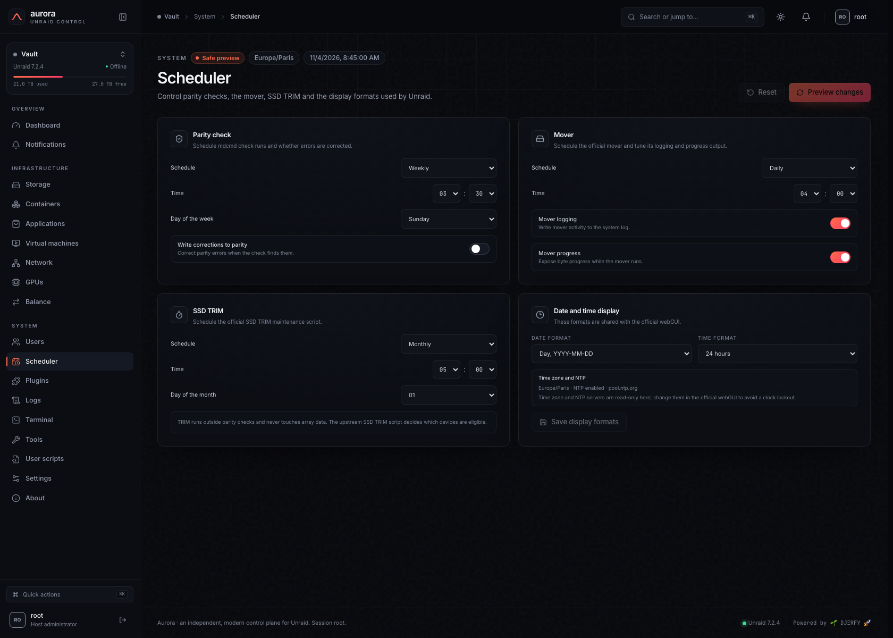
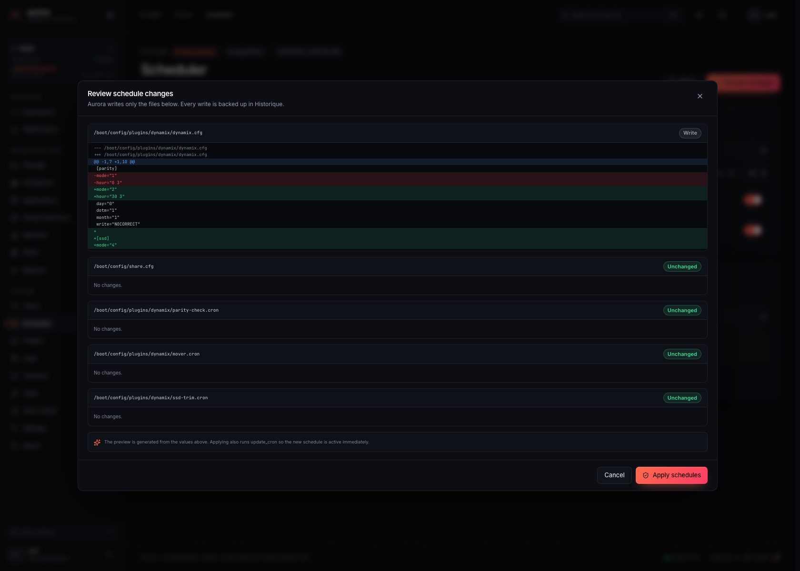

# Aurora User Guide

Aurora is a modern control plane for Unraid. It runs directly on the server, authenticates
against the native `root` account, serves the UI over HTTPS, and reads the host through the same
files and commands as the official webGUI.

> Screenshots in this guide use anonymised sample data. No real server details are exposed.

## Contents

1. [Sign in](#1-sign-in)
2. [Navigation and command palette](#2-navigation-and-command-palette)
3. [Dashboard](#3-dashboard)
4. [Notifications](#4-notifications)
5. [Storage](#5-storage)
   - [Array](#51-array)
   - [Location](#52-location)
   - [Disks and SMART](#53-disks-and-smart)
   - [Shares](#54-shares)
   - [Pools](#55-pools)
   - [Parity](#56-parity)
   - [Mover](#57-mover)
   - [Rebalancing](#58-rebalancing)
6. [Containers](#6-containers)
   - [Applications (Community Applications)](#applications-community-applications)
7. [Virtual machines](#7-virtual-machines)
8. [Network](#8-network)
9. [GPUs](#9-gpus)
10. [Users](#10-users)
11. [Plugins](#11-plugins)
12. [Logs](#12-logs)
13. [Terminal](#13-terminal)
14. [Tools](#14-tools)
15. [History (configuration history)](#15-history-configuration-history)
16. [Settings](#16-settings)
   - [Scheduler](#scheduler)
17. [Keyboard shortcuts](#17-keyboard-shortcuts)
18. [Safety model and backups](#18-safety-model-and-backups)
19. [Troubleshooting](#19-troubleshooting)

---

## 1. Sign in

- Aurora has **no local account database**. Credentials are checked against the host's
  `/etc/shadow` through `getent shadow root` / `/etc/shadow`.
- Only the native `root` account can sign in.
- Sessions are HMAC-signed, `HttpOnly`, and protected by origin checks and a custom request header.
- The UI is served over **HTTPS only** using the Unraid certificate bundle
  (`/boot/config/ssl/certs/<server>_unraid_bundle.pem`), with TLS 1.2 minimum.
- Three failed attempts trigger a temporary lockout.

---

## 2. Navigation and command palette

- The sidebar groups pages into **Overview**, **Infrastructure** and **System**.
- It can be collapsed; the choice is stored in the browser.
- The top bar contains the global search ("Search or jump to…"), theme toggle, notifications and
  account menu.
- The **command palette** (`⌘K` / `Ctrl+K`, or `/`) searches:
  - pages and global actions,
  - containers: name, state, image, network and IP,
  - virtual machines: name, state and operating system,
  - CVE IDs when Trivy scans are available.
- Typing a CVE (for example `CVE-2024-1234`) shows **Affected containers** and **Affected packages**.
  Selecting a container or package opens the Docker **Security** tab filtered by that CVE, grouped by
  container or package. The scan overview is loaded on demand and cached for 30 seconds.
- Selecting a container opens its details drawer; selecting a VM opens its drawer.
- **Container actions** and **VM actions** groups expose start/restart/stop shortcuts.

---

## 3. Dashboard

The dashboard is the operational summary of the host:

- **Health score** and detected issues, with uptime, Unraid version, kernel version and CPU temperature.
  The ring turns green when every health check reaches 100 %.
- **CPU** usage, temperature, package power and a live per-core matrix. The processor chart offers
  **1h / 24h / 7d / 30d** ranges backed by a persistent one-minute archive.
- **GPU** utilisation, VRAM, temperature, power, fan and clocks (first GPU, with a link to the GPU page).
- **Memory** used/available.
- **Array** state, capacity and protection.
- **Network** throughput and interface state.
- **Workloads**: running containers and VMs.
- **UPS** state when the built-in `apcupsd` service or the NUT plugin is running. The battery ring
  shifts from green at 100% to red at 20%, so a low charge is visible at a glance.
- **Recent notifications** and quick links to the relevant pages.

All widgets refresh automatically (default 5 seconds, configurable in Settings) and are driven by
live SSE metrics.

---

## 4. Notifications

- Inbox and archive, unread/archived filters and severity badges.
- Text search across titles, subjects and descriptions.
- **Acknowledge** moves a notification to the archive.
- **Acknowledge all** clears the unread inbox.
- The top bar shows the unread count and a short preview menu.
- **Settings → Notifications** can drop messages below a minimum importance, mute specific Unraid
  sources (for example `docker` or `vm`), and toggle event categories (array, disks, Docker, VMs,
  mover, plugins, UPS, system) before they reach Discord, ntfy or a webhook.
- Aurora also generates its own event alerts for parity start/stop, container state changes,
  unhealthy disks and unexpected VM shutdowns; the same category filters apply.

---

## 5. Storage

Storage is organised in tabs: **Array**, **Shares**, **Pools**, **Parity** and **Location**.

### 5.1 Array

- Array state, protection level, total/used/free capacity and live throughput.
- **Start array** / **Stop array** with confirmation.
- Start supports:
  - no key,
  - **passphrase** (printable ASCII, encoded like the official webGUI),
  - **keyfile** upload (written to Unraid's configured `luksKeyfile`),
  - **maintenance mode**.
- Disk groups: parity, data, cache pool and boot device.
- Spin up/down per disk, with live read/write throughput.
- SMART warnings are surfaced on the disk row.

### 5.2 Location

Location is a visual canvas of the physical chassis. It is server-specific and never changes Unraid's
disk assignments.

- The **Add** menu creates a **Server**, **Desktop** or **NAS** 3D-style chassis panel.
- Panels snap to a **12-column grid**, cannot overlap, and can be dragged anywhere on the board.
- Each panel has a rename field, a delete action and **Auto-arrange** support.
- Hover a panel to reveal its **edge and corner handles**, then drag to resize it freely on the grid.
- Resizing never overlaps another panel: the drag stops at the first occupied cell.
- On narrow screens the board becomes a stacked list while keeping saved positions.
- Inside each chassis, add and reorder **horizontal sections** (Data, Cache, Parity, custom).
- A section has a name, colour, media type (**Any / HDD / SSD / NVMe**), rows and columns.
- A media mismatch is allowed but shows a warning on the section and affected disk.
- Drag a disk from **Disks to place** into a bay, or select a disk then click an empty bay.
- Drag disks between bays, sections and chassis; removing a section returns its disks to the list.
- **Auto-place** fills the sections in reading order, preferring disks matching the section media, then
  parity → data → cache.
- **Reset layout** clears assignments but keeps panels and sections.
- Each assigned bay and tray card is compact and shows the essentials: name, brand + model, serial,
  size and temperature. A drive illustration hints at the physical media (HDD, SSD or NVMe), and
  the info button opens the existing disk drawer.
- **Disks to place** contains every unassigned drive with the same identity details.
- The v2 layout is stored in `$AURORA_CONFIG_DIR/storage-layout.json` (default
  `/boot/config/aurora`) and the previous column-based format is migrated automatically.

### 5.3 Disks and SMART

Open a disk to see:

- capacity, filesystem, used/free, temperature, error count;
- serial number, firmware, spin-up group, encryption;
- live I/O;
- **SMART** section with health, temperature, power-on hours, self-test status and the ATA/NVMe
  attribute table (value, worst, threshold, raw, failing rows highlighted);
- **Short test** button (`smartctl -t short`).

If `smartctl` is missing or the disk is in standby, the drawer explains why data is unavailable.

### 5.4 Shares

Share cards show usage, SMB/NFS state, cache mode and allocation. When
`shares.ini` has no size data, Aurora scans the merged share path
`/mnt/user/<share>` with `du` (the view that includes every data disk, cache pool
and secondary pool), caches the result for 6 hours and refreshes it in the
background (two shares at a time) so bootstrap latency is never affected.
**Recalculate usage** forces a new scan immediately; it also runs in the
background and updates each share as its scan completes. Disk
usage falls back to `statfs` when `disks.ini` omits it.

**Create a share**

1. Open **Storage → Shares**.
2. Click **New share** (top right).
3. Fill the settings below and click **Apply changes**.

**Rename a share**

1. Click the share card.
2. Click **Edit settings**.
3. Change the **Name** field and apply. Collisions are rejected; data stays on disk.

Share settings:

| Section | Options |
|---|---|
| Share | Name, comment, minimum free space (`0`, `10G`, `500M`…) |
| Storage | Primary storage (Array/pool), secondary storage, cache mode (`No`, `Yes`, `Prefer`, `Only`), allocation method (`High-water`, `Fill-up`, `Most-free`), split level, included/excluded disks, copy-on-write (`Auto`/`No`) |
| SMB | Export (`No`, `Yes`, hidden, Time Machine variants), security (`Public`, `Secure`, `Private`), case-sensitive names, Time Machine size limit |
| NFS | Export (`No`, `Yes`), security (`Public`, `Secure`, `Private`), host rules when private |

Every change is sent through the same emhttpd commands as the official webGUI. The share
configuration file is snapshotted before the command and recorded in **History**, so it can be
reviewed or rolled back.

### 5.5 Pools

- Pool capacity, usage, filesystem, devices and health.
- Cache/boot classification.
- Pool membership is derived from the live disk inventory.

### 5.6 Parity

- Current parity check progress, speed, elapsed time, ETA and errors.
- Start, pause, resume and cancel.
- Historical checks with duration, speed, status and error count.

### 5.7 Mover

- Start/stop the official mover in the background.
- Current share/action and file, global and per-share progress, throughput and ETA.
- The progress bar reaches **100%** when the remaining bytes reach zero or the ETA is exhausted; it
  reads Unraid's `mover.ini` from `/usr/local/emhttp/state` (or the configured state directory) and
  otherwise estimates from the per-share file lists created by the mover.
- Files are captured from the mover's `mover-files.*` lists and from `move:` lines in syslog, so
  automatic nightly runs also produce a file list.
- A collapsible **Recent runs** list keeps the last **10** mover runs with duration, moved/total
  bytes and the file list.
- Enabling **Settings → Scheduler → Mover progress** (or the card's **Enable Mover progress** button)
  makes the byte counters and ETA exact. The flag is read from `share.cfg`, with `var.ini` as a
  fallback on newer releases; without it, Aurora still reports the estimated totals and observed files.
- CA Mover Tuning runs are supported through its `Filtered_files_*.list`, so estimated totals still
  work when the plugin's live progress is disabled.

### 5.8 Rebalancing

Use this page to empty a disk before replacing it, or to move selected folders/files.

- **Source** and **Destination(s)** are detected from mounted `/mnt` entries.
- Two modes:
  - **Empty disk**: moves everything except `lost+found` and hidden folders;
  - **Folders / files**: browse the source disk, select folders or files.
- Options:
  - **Dry run** (default): scans and plans without writing or deleting;
  - **Delete source**: deletes each source file only after a verified copy;
  - **Overwrite**: overwrite existing destination files (off by default).
- Pipeline: **copy → size verification → source deletion**. Symlinks, hardlinks, permissions,
  ownership and timestamps are preserved.
- Live details: phase, bytes, files, speed, ETA, current path, per-file status
  (moved/planned/skipped/failed), errors and a journal.
- **Cancel** stops after the current file. The last 20 runs are kept in
  `$AURORA_CONFIG_DIR/balance-history.json` and shown on the page.

---

## 6. Containers

### Views and columns

- Grid or list view; the choice persists across refreshes.
- List columns: name, image, network, IP, mounts, state, CPU, memory, uptime and actions.
- The **Mounts** column lists every bind mount with its container path and `ro`/`rw` access;
  hover a row to see the full host → container mapping.
- Filters: **All**, **Running**, **Stopped**, **Updates**.
- Search covers name, image, network, IP and category.
- Cards show a coloured halo, live CPU/RAM, uptime, and collapsible sections for published ports, network/IP and mounts.
- **Visual folders**: create folders from the folder dropdown (**Folders**) in the list/grid toolbar and assign a container at
  creation or in **Edit settings**. Folders are stored in Aurora's configuration, are purely visual
  and never move data on disk. **Unfiled** is the default; deleting a folder moves its containers
  back to Unfiled.
- **Folder entries**: in the list view every folder gets its own table, listed first in their
  configured order, followed by an **Unfiled** table for the remaining containers. The chevron in a
  folder table header collapses it, and the toolbar button expands or collapses every folder at once.
  Each table uses the standard columns and rows (icon, image, state, metrics and actions). In the grid
  view, folders stay as cards and expand into the default container cards. Picking a folder in the
  toolbar dropdown applies the same filter.

### Resource map

The **Resource map** tab turns the running containers into a live scatter map:

- **Compute**: CPU on the X axis, memory on the Y axis, bubble size by memory.
- **Network**: receive and transmit rates (bytes/s) on the axes.
- **Disk I/O**: read and write rates (bytes/s) on the axes.
- Bubble colour identifies the container in every view.
- **Top consumers** ranks the six busiest containers for the selected view.
- The map fills the available width and can be resized vertically with the handle in its bottom-right
  corner; the chosen height is remembered in the browser.
- Hovering a bubble shows the container, image, CPU, memory, network RX/TX and disk read/write rates;
  clicking it opens the container drawer.

Rates are derived from Docker's cumulative counters between two polls, so the first sample of a
new container starts at zero and fills in on the next refresh.

### Network → Calls

The **Calls** sub-page of the **Network** tab lists the network sockets of a selected running container:

- Choose a container in the selector; the view stays empty until one is selected.
- Aurora enters the container network namespace with `nsenter` and reads `ss -tunap`.
- All remote addresses are shown, including private ranges and loopback; link-local, multicast and listening sockets are hidden.
- Each row shows the remote IP/port, optional country/city, process, protocol, state and local endpoint.
- The same table is available in the container drawer opened from the list or the resource map.
- The query refreshes every five seconds and is cached locally for the selected container.

Country and city are optional: install `geoiplookup` and a GeoIP database on the host. Aurora never
sends addresses to an external geolocation API.

### Network → Map

The **Map** sub-page of the **Network** tab turns the live sockets of running containers into a graph:

- Nothing is loaded until a container is selected. Choose a specific container, or **All containers**
  to aggregate every running container.
- Incoming peers are on the left, containers in the middle and outgoing peers on the right, so the
  direction of each conversation is visible at a glance.
- Aurora compares each established socket with the container listening and Docker-exposed ports:
  traffic accepted on a service port is **Incoming**, traffic from an ephemeral port is **Outgoing**.
  A low local port talking to a high remote port is also treated as incoming when `ss` did not report
  the listener.
- Peers are grouped by IP and classified as **Containers** (the IP belongs to another container),
  **LAN** (private address) or **Internet** (public address).
- Line thickness and node counters reflect the number of sockets; use the scope selector to focus on
  one category.
- Click a node to pin its edges, or hover a row in the **Who talks to whom** table to isolate a
  container.
- The table lists each container-to-peer pair with direction, scope, protocol, remote ports and
  socket count.
- Loopback sockets are hidden so the map only shows conversations with the outside or other
  containers.
- The map refreshes every 15 seconds; inspecting many containers may take a few seconds.

### Details

The drawer shows the real icon, state, image, repository/tag, category, restart policy, network, IP,
uptime, memory, published ports, network calls and live container logs with reload, search, copy and
download. **Open terminal** starts an interactive `docker exec` session in a new window.

Actions: start, restart, stop, open WebUI, update image, edit settings, open terminal, remove.

### Create, edit and snapshot VMs

- **New VM** creates a qcow2 disk under `/mnt/user/domains`, with vCPU/RAM/disk, network bridge and
  an optional ISO.
- The XML drawer is editable; the domain name is immutable through the editor and changes apply on
  the next boot.
- **Snapshots** can be created, restored and deleted from the VM drawer.

### Settings editor

Edit paths (bind mounts, read-only), published ports, environment variables and restart policy.
The **Advanced** section adds structured Docker options without handing Aurora a shell:

- host devices under `/dev`, with container path and `rwm` permissions;
- capabilities to add or drop, sysctls, labels, extra hosts, tmpfs mounts and DNS servers;
- fixed MAC address, hostname and CPU pinning (click the logical cores to pin);
- memory, CPU and PID limits, plus a read-only root filesystem and a **Privileged** toggle;
- **Extra parameters** for additional Docker CLI flags. Supported flags are applied on recreate and
  all values are kept in the Unraid template;
- **Post arguments** appended to the image command (shell-style quoting is supported).

Applying stops and recreates the container with rollback on failure. The Unraid XML template is
synchronised (including `Memory`, `CPUset` and managed `ExtraParams`) and the previous template is
stored in **History**.

### Docker images

The **Images** tab lists every Docker image on the host with its tags, short ID, size, creation date
and the containers using it.

- **Remove unused** deletes every image that is not referenced by a container. Images used by a
  running or stopped container are skipped and reported separately.
- The trash button is disabled for images still used by a container.
- Image removal never uses Docker's `force` flag. After an image update, Aurora also removes the
  previous image when no other container references it, and silently keeps it otherwise.

### Create a container

- **New container** opens a form with:
  - optional template picker (existing `my-*.xml` from the flash drive),
  - name, repository/image, network (bridge/host/none/custom), restart policy,
  - icon URL, WebUI, privileged mode,
  - paths, ports, environment (`PUID`/`PGID`/`UMASK` prefilled),
  - advanced devices, capabilities, sysctls, ulimits, labels, extra hosts, tmpfs, DNS, MAC,
    hostname, CPU pinning and resource limits.
- The image is pulled when missing; the container is created and started.
- Templates prefill every field and can be used to relaunch a container after a failed creation.

### Image updates

- **Check updates** compares local repository digests with registry manifests (Docker Hub, GHCR,
  private registries with `~/.docker/config.json` credentials).
- Badges appear on cards, list rows, the Updates tab and the dashboard.
- Updating pulls the image and recreates the container with its current settings; the UI streams
  each step (pull progress, stop, recreate, start, cleanup) in real time.
- Pulls have no total time limit, so multi-gigabyte images can finish on a slow link. Aurora only
  aborts after `AURORA_DOCKER_PULL_STALL` (default `10m`) without any Docker progress, and the pull
  keeps running server-side if the browser tab is closed.
- An image update never rewrites the Unraid template: Docker inspect exposes image labels, generated
  MAC addresses, hostnames and runtime limits that do not belong in `<ExtraParams>`. Settings edits
  update the raw `ExtraParams` and `PostArgs` fields.
- A white **Force update** button on cards, rows and the container drawer repulls the image and
  recreates the container even when no newer digest is flagged. The yellow **Update** badge remains
  the update indicator.
- **Update all** processes every outdated container sequentially.
- Each successful update adds a `container.image.update` entry to **History** with the previous and
  new image digest and image ID. The entry is informational and cannot be rolled back from History.

### Image security

- Enable **Settings → Image scanning** to install Trivy and its vulnerability databases (the main
  vulnerability DB and the Java DB). The binary, cache and scan results live under
  `AURORA_TRIVY_DIR` (default `<AURORA_CONFIG_DIR>/trivy`).
  Because Unraid often mounts `/boot` with `noexec`, Aurora re-materializes the binary in an
  executable runtime directory (`AURORA_TRIVY_RUNTIME_DIR`, default `/usr/local/aurora/trivy`, then
  `/tmp/aurora-trivy`) on every start. The persistent copy remains the source of truth.
  Both databases live in the same persistent cache (`cache/db` and `cache/java-db`); the Java DB is
  required to analyse JAR dependencies.
- The Settings panel can install a specific release or update to the latest stable one, download or
  refresh both databases manually, and chooses the nightly database update hour.
- While scanning is enabled, Aurora keeps the selected binary, its executable runtime copy and both
  databases installed, downloading anything missing automatically.
- Images are scanned automatically after a pull, after a container is created or recreated. Scans are
  not queued until both vulnerability and Java databases are present, and they pause while the
  databases are being installed or refreshed; while waiting, containers show **Not scanned**.
  Downloading or updating the databases does **not** trigger a full rescan of every image. Use
  **Scan images** or **Scan now** when you want a fresh pass; this avoids a resource spike.
- A **Security** column splits findings into compact count badges: red critical, orange high, yellow
  medium, blue low and grey unknown. When there is no finding, a green **0** badge keeps the same
  compact format. The card view exposes the same breakdown in a collapsible **Security** section
  below **Mounts**.
- **Scan images** in the page header scans every unique container image, like **Check updates** does
  for image updates. It is disabled until Trivy and both databases are ready.
- The container drawer shows the full severity breakdown, scan date, Trivy and database versions,
  filters, and the finding list with package versions, fixed versions and advisory links. **Scan now**
  forces a fresh scan.
- The **Security** tab next to **Network** merges every scan into one overview. Totals are
  deduplicated by image ID, and the same data can be grouped by image, container, CVE, package or
  severity. Search and severity filters narrow the result; container chips open the container drawer.

### Applications (Community Applications)

The **Applications** page browses the official Community Applications feed:

- search across Docker applications and plugins, filter by type and category, and sort by downloads,
  name or update date;
- open an application drawer with its overview, repository, author, support link and requirements;
- **Review & install** downloads the Unraid template, opens the normal container form with every
  field prefilled, and waits for an explicit **Create & start**;
- plugins are installed through the official plugin manager after a separate confirmation warning;
- installed applications show **Installed** or **Update available**. That badge comes from the last
  Docker image update check, not from the feed date; use **Check updates** to refresh it;
- when a newer digest is found, **Update container** pulls the image and recreates the container with
  its current settings, exactly like the Docker page;
- Aurora never executes a Docker template or plugin without that review step.

### Autostart, priorities and removal

- **Start with the array** toggles Unraid's `/var/lib/docker/unraid-autostart` entry.
- **Priorities** (page header) assigns a startup priority from **0** (starts first) to **100**
  (starts last); the default is **50**. Bulk starts and restarts are sorted by priority.
- Saving priorities also reorders `/var/lib/docker/unraid-autostart`, so the Unraid array start uses
  the same order. Put databases, caches and registries first, then frontends and web services.
- **Remove container** asks for confirmation; bind mounts and appdata stay on disk.

---

## 7. Virtual machines

- Grid or list view, persisted across refreshes.
- Cards and rows show state, OS, vCPU, memory, CPU/RAM usage, IP, primary GPU and uptime.

- Lifecycle: start, suspend/resume, shut down.
- **Autostart** toggle uses libvirt `virsh autostart`.
- **XML** opens the libvirt domain definition, editable with copy-to-clipboard.
- **Hardware** edits vCPU, memory, CPU pinning (clickable logical cores), network bridge/model/MAC,
  virtual sound, virtiofs shared folders and PCI/USB passthrough with IOMMU group hints.
- **USB passthrough** hot-plugs a host USB device into a running guest, or records it in the domain
  definition when the guest is stopped.
- **Clone** copies the domain, disks and NVRAM into a new VM with fresh UUID and MAC addresses.
- **Expand disk** grows the first file-backed vDisk, online with `virsh blockresize` or offline with
  `qemu-img resize`.
- **Console** opens the VNC/SPICE console.
- **Logs** opens the libvirt domain log (`/var/log/libvirt/qemu/<domain>.log`), with the same
  filter, reload, copy and download actions as container logs.
- **Backup** opens an offline backup and restore dialog. A backup writes a manifest, the domain XML,
  NVRAM and a qcow2 copy of each disk into a new folder under `/mnt`; it reports progress, supports
  cancellation and verifies checksums on restore. Backups and restores require a stopped VM.
  Restoring moves existing disks to `*.aurora-pre-restore-*` files before replacing them, and rolls
  them back if the operation fails. Both operations appear in **History**.
- **Folder** (drawer) and the picker in **New VM** assign a visual folder. Folders are shared with the
  folder dropdown in the page toolbar, stored in Aurora's configuration and never change the domain or disks.
- **Folder entries**: in the list view every folder gets its own table, listed first in their
  configured order, followed by an **Unfiled** table for the remaining machines. The chevron in a
  folder table header collapses it, and the toolbar button expands or collapses every folder at once.
  Each table uses the standard columns and rows, with console access, state and actions. In the grid
  view, folders stay as cards and expand into the default machine cards.
- **Autostart order** (page header) stores a deterministic start order, can start the VMs immediately,
  and can take over libvirt autostart: Aurora then disables the per-VM libvirt autostart flags and
  starts the ordered VMs once the array reaches `STARTED`. The takeover is reversible and visible in
  the dialog.

### Details

The drawer shows OS, machine type, vCPUs, memory, IP, uptime, last start, primary GPU, CPU/memory/disk
utilisation, autostart and actions.

### Console

- Full-screen **VNC** viewer over an authenticated WebSocket proxy.
- The upstream port comes from the domain XML; no client-supplied target is accepted.
- **New window** opens a standalone console page.
- Keyboard input is captured at document level and can be sent via **Ctrl+Alt+Del** for Windows
  guests.
- **Paste clipboard** forwards the local clipboard to the guest through the RFB client cut-text
  message.
- If keystrokes do not reach a guest, check that the domain defines an `<input type="keyboard">`
  device; Aurora shows a warning in the console when it is missing.

---

## 8. Network

- Interfaces, MAC, IPv4/IPv6, speed, state and live RX/TX.
- **Interface selector** (top right): chooses which interface drives the Download/Upload cards,
  totals, connection panel and traffic chart. The choice is stored on the device; the default is
  `br0`, then the first active interface. The Dashboard Network card exposes the same selector.
- Gateway, DNS and domain.
- WireGuard status and peers.
- Listening services with protocol, status and direct links.
- Traffic chart.

### Edit interfaces

**Edit configuration** opens a form for every interface stored in `/boot/config/network.cfg`.
Each interface card also has its own edit button, and the form switches between the configured
interfaces with tabs (for example `br0`, `br1`, `bond0`).

For the selected interface you can change:

- DHCP or a static IPv4 address, subnet mask and gateway.
- Optional custom MTU.
- Bonding with mode and member selection.
- Bridging with member selection and spanning-tree control.
- DNS servers, which are shared by every interface on the flash drive.

The editor also shows the live interface state with a green/red badge and lets you **Bring up** or
**Bring down** the configured interface. Bringing an interface down asks for confirmation because the
current connection may drop; the request is deferred for two seconds so the UI can acknowledge it.

Aurora validates every address, mask, gateway, MTU and interface name before writing. Each save
creates a timestamped backup next to `network.cfg` (the last ten are kept). Changes are written
without touching live networking: reboot the server to apply them, or use **Apply now** to restart
`/etc/rc.d/rc.inet1` after an explicit confirmation. **Revert** restores the most recent backup.

If a static change would place the current client outside the new subnet, Aurora refuses to save
until you explicitly acknowledge the lockout risk. VLAN and WireGuard editing remain on the roadmap.

---

## 9. GPUs

- NVIDIA through `nvidia-smi`, AMD/Radeon through `rocm-smi`.
- Per GPU: utilisation, VRAM used/total, temperature, power draw, power limit, fan, core and memory
  clocks.
- Active compute processes with PID and memory.
- Telemetry is sampled every 30 seconds so an idle GPU is not woken unnecessarily. Aurora never uses
  the GPU itself: the dashboard is rendered by your browser, and this page only reads host telemetry.
- Vendor logo and neutral icon frame.
- Empty state explains how to install the Nvidia Driver plugin.

---

## 10. Users

- Account list with role, UID, last activity and share access.
- **Add user** creates the Unix account, Samba credentials and share access through emhttpd.
- **Edit** changes the description.
- **Change password** sends the new password once to emhttpd (base64), never stores it.
- **Delete** removes a non-root account after confirmation.
- Avatars are read from `/boot/config/plugins/dynamix/users/<name>.png`.
- Passwords are never logged or persisted by Aurora.

---

## 11. Plugins

- Real `.plg` metadata: name, version, author, category, description.
- **Check updates** downloads each plugin definition and compares versions.
- **Update** runs the official plugin manager and streams its output.
- **Install plugin** accepts an `.plg` URL; **Remove plugin** deletes it through the plugin manager.
- All operations show a live output modal and require explicit confirmation.
- The **Applications** page provides the Community Applications catalog for Docker apps and plugins; plugin installs still use this official plugin manager.

---

## 12. Logs

Sources:

- **Syslog** (`/var/log/syslog`)
- **Docker** (`/var/log/docker.log`)
- **Nginx** (`/var/log/nginx/*.log`, merged with file prefixes)
- **Libvirt** (`/var/log/libvirt/libvirtd.log`, fallback `libvirt.log`)
- **Maillog** (`/var/log/maillog`, fallback `mail.log`)
- **Parity** (`/var/log/parity.log`)

Controls: level filter (all/info/warn/error), text filter, follow/auto-scroll, export to file.
Missing logs show an explicit message with a retry button instead of a generic error.

---

## 13. Terminal

- Interactive **root shell** over an authenticated WebSocket + PTY.
- Opens the authenticated account's default shell from `/etc/passwd` (login profile), with `/bin/sh` as fallback.
- Full-page layout, dark theme, no fake window chrome.
- **New window** opens the standalone terminal page.
- Keyboard shortcuts are not intercepted by Aurora while the terminal is focused.
- Commands run as root on the host: treat the session as host-level credentials.

---

## 14. Tools

- **Download diagnostics** builds a ZIP on demand:
  - host identity (`uname`, `uptime`, hostname);
  - `df`, `free`, `lspci -nnk`, `lsusb`, `ip addr`, `ip route`;
  - Docker containers/images/networks and libvirt VMs;
  - Unraid state files (`var.ini`, `disks.ini`, `shares.ini`, …);
  - Unraid config files (`disk.cfg`, `ident.cfg`, `share.cfg`, `docker.cfg`);
  - Aurora settings, image update status, mover and balance history;
  - installed plugin list;
  - tails of syslog, docker and libvirt logs.
- Credentials, tokens, webhook URLs and similar keys are redacted in the diagnostics archive.
- **Export redacted configuration** produces a restorable-looking support archive with the same
  sensitive values removed; the normal export is kept faithful for a real restore.
- Host summary and snapshot counters.
- Nothing is stored server-side; the archive is generated per request.

---

## 15. History (configuration history)

Every file-backed configuration change made by Aurora is snapshotted before writing:

- container XML templates,
- Docker autostart list,
- share configuration files (create/rename/edit),
- any future file-backed setting using the same helper.

Each entry shows the action, description, affected files, previous size and a **Difference** view.
**Rollback** restores the previous contents; the current state is snapshotted first, so a rollback
can itself be reverted.

Successful container image updates are also recorded. Their entry uses the virtual path
`docker://<container>/image` and diffs the resolved image digest (`sha256:...`) and image ID before
and after the pull. These entries are informational: they have no file backup and cannot be rolled
back from History. Deploy the previous image tag to revert.

- Storage: `$AURORA_CONFIG_DIR/config-history/<id>/` (`meta.json`, `files/`).
- Limit: 200 entries.
- Some emhttpd-managed changes (shares, users) may require a service reload or restart before the
  restored file is applied in memory.

---

## 16. Settings

- **Theme**: dark, light, or automatic.
- **Accent**: five palettes.
- **Density**: comfortable or compact.
- **Surfaces**: Standard (default) or Glass. Standard is completely blur-free, including the cards,
  menu and navbar. Glass applies the frosted material to cards, panels, popovers, the menu and the
  navbar. The preference is stored on the current device and respects reduced-transparency settings.
- **Wallpaper**: choose a PNG, JPEG or WebP image displayed behind the cards. The image is darkened by
  50 % for contrast and stored on the current device (resized to 2560 px and compressed when needed).
  In glass mode, a pre-blurred copy is generated once and used as the background. Use the trash button
  to remove it.
- **Performance mode**: disables wallpaper, backdrop blur, background effects and most animations on
  this device. Use it when the dashboard's visual effects keep a GPU busy; the live metrics stream
  also pauses while the browser tab is hidden.
- **Temperature unit**: Celsius or Fahrenheit.
- **Server display name**.
- **Refresh interval**.
- **Language**: English (default) or French. The switch previews immediately; **Save changes** persists it on the server.
- **Automatic updates**, **anonymous telemetry**, **email alerts**, **push notifications**.
- **Outbound notifications**: Discord webhook, ntfy URL and a generic webhook (GET/POST/PUT/DELETE,
  custom headers and body template with `{title}`, `{subject}`, `{description}`, `{importance}`,
  `{source}` and `{timestamp}` placeholders), with a test button. New Unraid notifications are
  forwarded after Aurora starts.
- **MCP server**: enables the integrated HTTP endpoint at `/api/v1/mcp`. Disabled by default; the
  local `aurora mcp` stdio mode is unaffected.
- **Docker**: enable the Docker service, stop timeout, PID limit, vDisk type/size/location,
  appdata path, log rotation/size/files, template authoring mode, custom network type, host access
  and user-network preservation. The running Docker version and storage driver are read-only. Values
  are written to `/boot/config/docker.cfg`; restart Docker or the array to apply storage or service
  changes.
- **VM Manager**: enable VMs, hide the autostart/start options for every VM, and set the optional
  default Windows VirtIO driver ISO. Values are written to `/boot/config/domain.cfg`; restart the
  array to apply service changes. The libvirt running state is read-only.
- **NVIDIA driver**: drives the official **Nvidia Driver** plugin. Shows the running module version,
  license, kernel and detected GPUs, then lets you pick the **Latest**, **Production Branch**,
  **New Feature Branch** or **Open Source** driver, or a specific version available for the running
  kernel. Aurora stages the chosen package in `/boot/config/plugins/nvidia-driver/packages` and
  updates the plugin settings; the plugin installs it at boot, so a reboot is required. Docker image
  pulls and the running module are never touched while the server stays online.
- **Outbound proxy**: enable a global proxy and store up to four named configurations (URL plus
  optional username/password). Only one configuration is active at a time. The proxy applies to
  Aurora's internet traffic: Docker registry digest checks, the Community Applications catalog,
  plugin and Unraid OS updates, Trivy downloads and outbound notifications. Docker and VM API calls
  over the local socket are never proxied. Saved in Aurora's settings file; no restart is needed.
- **API tokens**: create named **Viewer**, **Operator** or **Admin** bearer tokens. Unscoped tokens
  can also authenticate the MCP endpoint (`/api/v1/mcp`); scoped tokens only reach the matching MCP
  tools. See [`MCP.md`](MCP.md). Viewers can only
  read, operators manage containers, VMs, array and mover actions, and admins control everything.
  Tokens can expire after 30, 90 or 365 days (or never) and can be limited to specific scopes.
  The secret is shown once; token management itself requires a signed-in session. The **Security**
  section lists active sessions with their IP and last activity, allows revoking one session, and
  **Revoke all sessions** invalidates every Aurora cookie, including the current browser. Sessions
  survive an Aurora restart because the signing key and registry are persisted in the config directory.
- **Unraid OS**: current version and branch, update check against `releases.unraid.net`, release
  notes, streamed installation through the official plugin manager, and a downgrade that restores
  the boot files kept in `/boot/previous`. A reboot is required to boot the new or restored version.
- **Unraid API**: installed state, version, process controls (start, stop, restart), service
  configuration and the latest API/PM2 log lines.
- **Scheduler**: choose parity, mover and SSD TRIM schedules, review a per-file diff (green additions,
  red deletions) before applying, and activate the result through `update_cron`. Files that are already
  up to date are left untouched to limit flash writes. The display date/time
  formats can also be changed here; time zone and NTP stay read-only to avoid a clock lockout.
- **Image scanning**: enable Trivy, install or change the binary version, download/update the
  vulnerability and Java databases, and choose the nightly database update hour. Scans surface in
  the Containers page and drawer.
- Session information: account, authentication, HMAC session store, CSRF protection.
- About: Unraid version, kernel, uptime, board, memory, license.
- The **System → About** page describes Aurora, the author (🌱 DJΞRFY 🚀), the public repository and the AGPL-3.0 license.

### UPS, ZFS, user scripts and audit

- **Settings → UPS** shows battery/load/runtime, edits the apcupsd shutdown policy, and can write the
  NUT plugin connection, thresholds and monitor password before restarting its service.
- **Storage → ZFS** lists pools and datasets, starts a scrub, creates datasets with compression,
  quota and recordsize, edits their properties, deletes them, and creates, rolls back, clones or
  deletes dataset snapshots.
- **User scripts** lists the User Scripts plugin inventory, shows and edits the source, runs a script
  as root and returns its output. The schedule editor writes the plugin's `schedule.json` and cron
  fragment: disabled, hourly, daily, weekly, monthly, array start/stop, first array start, or a
  five-field custom cron expression. Unraid's `update_cron` helper is invoked after a change.
- **Tasks** lists only the work currently running: share usage scans, mover runs, balance jobs,
  Trivy installs/database updates and image scans, with status, progress and the PID of the
  process doing it. Queued and completed work never appears there: finished jobs are listed in
  **Logs → Tasks**.
- The **Logs** page groups three tabs: **Logs**, **Audit log** and **History**. Its **Tasks**
  source lists completed background work (share scans, mover, balance, Trivy scans) with duration
  and outcome. The audit tab records
  every mutating API call with user, method, path, status and remote address, filters by method,
  status class or user, and exports the visible entries as CSV. The in-memory log keeps 5000 entries
  by default (`AURORA_AUDIT_LIMIT`).

---

## 17. Keyboard shortcuts

| Shortcut | Action |
|---|---|
| `⌘K` / `Ctrl+K` | Open/close the command palette |
| `/` | Open the command palette when not typing |
| `?` | Show the keyboard shortcut help |
| `↑` / `↓` | Move through palette results |
| `Enter` | Run the selected command |
| `Esc` | Close overlay/drawer/palette |

Aurora's shortcuts ignore inputs, textareas, selects, contenteditable elements and the terminal/VNC
canvas so they never steal keystrokes from a console.

---

## 18. Safety model and backups

- All mutations are authenticated and CSRF-protected.
- `AURORA_READ_ONLY=1` rejects every mutation at the API layer.
- Destructive container operations use inspect → stop → rename → create → start with rollback.
- Container image updates pull first, then recreate with the current configuration.
- Share/user operations run through **emhttpd** (`/usr/local/sbin/emcmd`), never by editing live
  system databases directly.
- File-backed changes are snapshotted in **History** with unified diffs and reversible rollback.
- Rebalancing never deletes a source file before a size-verified copy; **dry run is enabled by
  default**.
- Credentials are read from the host only (shadow, `~/.docker/config.json`) and never written by
  Aurora.

> The Linux binary is distributed without the executable bit on GitHub Releases. Run
> `chmod +x aurora_<version>_linux_amd64` after download.

---

## 19. Troubleshooting

| Symptom | What to check |
|---|---|
| Login fails | Confirm the `root` password works over SSH or the Unraid console; Aurora reads `/etc/shadow`. |
| "unsupported Unraid version" at startup | Aurora only runs on **Unraid 7.x**. Version 6.x, 8.x and unknown builds are refused; check `/etc/unraid-version` and `var.ini`. |
| "cannot verify the Unraid version" at startup | Neither `/etc/unraid-version` nor the `version` field in `var.ini` is readable. Aurora fails closed instead of running against an unknown state format. |
| "Cannot locate the TLS certificate" | Check `/boot/config/ssl/certs/<server>_unraid_bundle.pem` or set `AURORA_TLS_CERT` / `AURORA_TLS_KEY`. |
| A log source returns "unavailable" | The file does not exist on this host (for example `libvirtd.log` or `maillog`); enable the corresponding service logging. |
| Container update check fails | The host needs outbound HTTPS access to the registry; private registries need credentials in `/root/.docker/config.json`. |
| Share/user change is rejected | Validation is strict; check the message and the official webGUI for the same values. |
| VNC keyboard does not reach the guest | Check the VM has a keyboard device and see issue #1. |
| Service logs | Use `-log-file`, `-log-format json`, `-log-level warn` and `-daemon`; see the README for environment variables and flags. |

---

## Further reading

- [README](../README.md) — installation, flags, environment variables, release process.
- [Architecture](ARCHITECTURE.md) — internals, providers, authentication and security.
- [API reference](API.md) — endpoints, token roles, error format and examples. On a live host, Redoc renders the same reference at `/api/docs`.
- [Unraid documentation](https://docs.unraid.net) — host behaviour and configuration reference.
